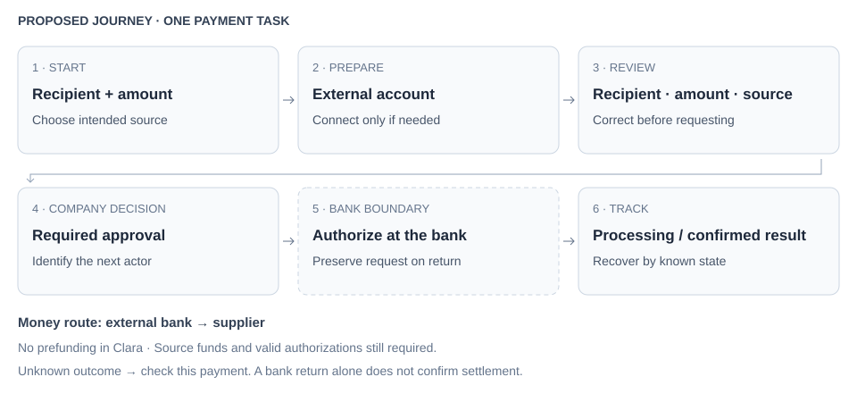

# Clara — initial analysis of the brief and current payment flow

For this Design Engineer case in Product Finance, I started with the brief and available references to understand the operation before defining a solution. The challenge is to let a finance team pay suppliers through Clara using funds held at another bank while preserving approvals and traceability. The brief defines Open Finance payment initiation as the opportunity. My hypotheses concern the experience of completing that task, alongside existing approval and tracking controls.

Research consolidated on October 13, 2026. **Demo** identifies my screenshots; **official documentation** identifies Clara's public materials; **hypothesis** identifies design interpretation; **reconstruction** identifies diagrams of uncaptured states. Transaction dates do not establish the UI version.

## Brief and evaluation criteria

The brief describes a finance manager at a Brazilian company with 200 employees, accounts at two traditional banks and dozens of supplier payments each week. The manager currently needs to open the bank, transfer money to Clara, return to Clara and only then pay.

The evaluation asks for problem framing and a metric, Pix and Open Finance context, first connection and consent, a payment and at least one failure scenario in high fidelity. It also asks for explored alternatives, reused components, a design system contribution and a record of AI use, including mistakes and time spent. The presentation allows approximately 30 minutes for the walkthrough and 15 for discussion.

Source: the private brief I received during the interview process. These requirements describe the evaluation; this document records my initial analysis.

## Product context and the brief

### What Clara brings together

Clara positions its platform around company spending: corporate cards, expense control, supplier payments and a digital account. The value proposition connects transactions with the information and controls needed to manage them. Its Brazilian product pages also promote payment automation, ERP integration and cash-management options. These statements describe Clara’s public positioning. Sources reviewed October 14, 2026: [Clara product overview](https://www.clara.com/pt-br) and [Accounts Payable](https://www.clara.com/pt-br/produtos/contas-a-pagar).

### The work behind the product

| Financial job | Product context | What matters for this case |
| --- | --- | --- |
| Organize company spending | Cards and expense records connect transactions to business context. | A supplier payment belongs to a wider financial routine. |
| Decide what can be paid | Requests and configured approval rules structure company decisions. | Speed must preserve authority and review quality. |
| Execute and follow the money | Payments and the digital account support money movement and its records. | The source, outcome and next action must remain understandable. |
| Close the operational loop | Records and integrations support financial follow-up. | A visible success state must correspond to a traceable outcome. |

### Positioning and ambition

I read Clara’s connected portfolio as an ambition to support more of the company’s spending routine, from the decision to spend through payment and reconciliation.

There is a business tension worth investigating: the product promotes account usage and cash-management services, while the brief describes a customer whose funds remain at other banks. Serving that routine could matter for payment usage, but I do not yet know the economics, eligibility or effect on account balances. I would need internal evidence before treating any of these as a business result.

> **What this means for the case:** the manager organizes payments in Clara while the funds remain elsewhere. I will assess the experience through operational effort, control, continuity and traceability, using the audit to identify where the proposed initiation flow needs to improve the task.

## Current journey and evidence coverage

**External bank → Clara top-up → Payments → New payment → beneficiary identification and entry → review and request → configured approvals → processing → tracking and receipts.**

I separated the journey by evidence source: the top-up comes from the brief and the Payments list is what I observed in the demo. Creation, invalid-key error, email code confirmation, processing in the list and the Pix receipt have images. Review and request approval have official descriptions but no detail screenshot. Approval configuration has images and is different from approving an individual payment. Uncaptured states have separate diagrams for validation.

| Stage | Available evidence | Still to observe |
| --- | --- | --- |
| Fund the account | Brief describes the problem; demo shows Top up | Top-up flow and return |
| Open Payments | Full demo screenshot | Per-row menu behavior |
| Create and validate | Official form, GIF and invalid-key error | Valid beneficiary and transition to review |
| Review and request | Review button and official code screen; submission described | Pre-submission summary and request confirmation |
| Approve a request | Written guide and visible tabs | Approver detail and decision history |
| Process and track | Processing in demo; official Pix receipt panel | Failure detail, receipt PDF and decision history |

## Critical audit of the current experience

I reviewed the supplied demo screens and the official flow references in this document. This is a heuristic audit, not an observed usability study. I distinguish a problem stated in the brief, a risk visible in the interface and a state I have not captured. Priority here means relevance to the brief and possible consequence, not measured frequency or a numerical severity score. Each crop isolates the area I am discussing; select it to inspect the original full screenshot.

### A1 · Before paying, the account needs to be funded

**From the brief:** the company holds funds at two traditional banks. To pay suppliers through Clara, the manager first transfers funds into the Clara account.

The diagram makes the dependency described in the brief visible. It does not document the external bank's screens, transfer time or the way the manager confirms that the funds arrived.

> **My reading · A1:** paying a supplier includes preparatory work before the payment itself. I want to understand how the manager coordinates that preparation and keeps track of the intended payment when moving between the bank and Clara. The extra step is explicit in the brief; its impact on effort, errors or abandonment still needs investigation.

**Question to investigate:** how much work does funding add, and what information does the manager need to resume the payment confidently once the money is available?

**Benchmark cross-check:** Mercury makes account identity visible in request and review; Wise distinguishes funding from transfer progress. These references help me investigate source clarity and continuity. They do not establish which external-bank capabilities Clara can offer.

> **Hypothesis to test · A1:** keeping the payment context and funding state understandable throughout preparation may help the manager resume the task with less reorientation. I would compare correct completion and active handling time, including funding preparation. This informs H1; it does not yet select a payment route or assume that Clara can remove bank authorization.

### A2 · Outcome labels carry more meaning than their shared color

**Evidence — Payments demo:** Paid and Reversed have green badges. Their text is different. The screen already provides statuses, search and receipt access.

**My assessment:** a quick scan by color may group a completed payment with a returned one. That is a visibility risk, not proof that people confuse them or that the screen fails accessibility. I would retain explicit labels and test how people interpret the outcomes.

**Benchmark cross-check:** Nubank's tutorial and Cora's historical animation pair an explicit result with amount, recipient and receipt access. Mercury instead confirms a request was created. The contrast is useful: completing a request and completing a transfer are different outcomes.

> **Hypothesis to test · A2:** distinct textual outcomes, supported by consistent semantic treatment and transaction detail, may help a person explain whether money moved and what to do next. This informs H2/H3; a new color palette alone would not establish the gain.

### A3 · A queue supports action, but decision context still needs inspection

**Evidence — Tasks demo and approval guide:** the queue exposes requester, amount, waiting time and an Approve action. The guide describes reviewing payment details and configured approvers. The individual approval detail is not captured.

**My assessment:** the queue makes pending work visible, which I would preserve. Repeated overdue labels may offer limited prioritization, but I cannot conclude that urgency rules are missing. Nor can I infer that the visible Approve action bypasses review.

**Benchmark cross-check:** Ramp exposes next-approver filtering; Conta Simples documents decision reasons and who acted and when. These support questions about responsibility and decision quality, rather than a justification for replacing Clara's approval engine.

> **Hypothesis to test · A3:** a clear next actor and a concise decision summary may reduce uncertainty about who acts and whether approval releases funds. This informs H2 within the payment flow required by the brief. I would first inspect the existing detail and ask a participant to explain the pending state.

### A4 · Existing validation is a foundation to preserve

**Evidence — official entry/error frames:** the form groups financial information and supporting documents; an invalid key has adjacent error text and prevents review.

**My assessment:** this already supports error prevention. The missing evidence is what happens after a valid lookup and how recipient identity, amount and source appear in review. Missing screenshots are not missing product features.

**Benchmark cross-check:** Mercury groups required and optional fields and shows local upload progress. Nubank exposes interpreted recipient details before the Pix action. Cora separates review from transaction authentication, although its visual reference is historical.

> **Hypothesis to test · A4:** adjacent feedback and a review hierarchy emphasizing recipient, amount and source may help people detect a mismatch without rereading explanatory blocks. This informs H4. I would keep Clara's existing validation behavior and measure errors caught, not simply clicks removed.

### A5 · Failure labels do not establish the recovery experience

**Evidence — Payments demo and official status documentation:** failure and processing states exist. A failure-detail screen and the uncertain-outcome recovery path have not been captured.

**My assessment:** I cannot claim Clara loses context or encourages duplicates. I can identify a consequential question: how does someone distinguish a definitive failure from an outcome that has not yet been confirmed?

**Benchmark cross-check:** Ramp documents reasons and available actions; Wise distinguishes funding and transfer milestones. Neither provides a direct visual precedent for every Pix failure in this case.

> **Hypothesis to test · A5:** preserving the request and offering a state-specific next action may support recovery without repeated entry or duplicate intent. This informs H3 within the same payment flow. Unknown outcomes need status verification before a new submission can be considered safe.

### A6 · Dense information needs hierarchy, not a cosmetic reset

**Evidence — supplied Summary, Tasks and Payments screens:** several summaries, statuses and actions compete within broad tables; some actions are icon-only. The Summary capture also shows horizontal overflow. Capture size and demo data may affect that layout.

**My assessment:** these are reasons to check scanning, responsive layout and action recognition. They do not establish insufficient contrast, absent tooltips, keyboard failure or poor real-world performance. I have not tested those behaviors in the authenticated product.

**Benchmark cross-check:** Ramp uses restrained list hierarchy and Mercury groups task fields. I would borrow their grouping principles while retaining familiar payment vocabulary and the existing company's controls.

> **My reading · A6:** the DS can make spacing, text roles, status treatment and interaction states predictable across my proposal. It cannot fix a funding dependency or make an unclear process understandable by itself. My visual direction is a case design choice; its value must be demonstrated through task comprehension and consistency.

### From audit to the brief's experience hypotheses

| Audit | Design responsibility | Hypothesis |
| --- | --- | --- |
| A1 | Replace the separate manual top-up task with understandable external-source payment initiation. | H1 · source and continuity |
| A3 / A2 | Preserve company policy and clarify each action's consequence. | H2 · commitment |
| A4 / A6 | Preserve validation and make payment review easy to check and correct. | H4 · review |
| A5 / A2 | Explain outcomes and retain the request for safe recovery. | H3 · recovery |

The benchmark informs interaction mechanisms for these hypotheses. All four belong to the single opportunity defined by the brief.

## Audit-driven interface decisions

| Finding | Design commitment | Shared API / contract | Validation before claiming improvement |
| --- | --- | --- | --- |
| A2 · status meaning | Separate request, approval, processing, reversal and settlement in words; color is supporting information. | PaymentStatus, Badge, Timeline; visibility and semantic consistency | Ask whether funds moved and who acts next at each state. |
| A3 · decision context | Keep amount, recipient and responsible actor near the decision; preserve company approval rules. | ReviewSummary, Button; recognition and error prevention | Correct interpretation of actor and consequence; no bypass of approval. |
| A4 · validation | Keep labels, adjacent errors and entered values; distinguish lookup feedback from payment outcome. | Field, InputGroup, Alert, Button loading; prevention and feedback | Keyboard completion, error association, mismatch detection and retained data. |
| A5 · uncertain outcome | Preserve request identity; verify its status before offering resubmission. | PaymentStatus, Timeline, Alert; recovery contract plus service state model | No duplicate intent in uncertain-result scenarios; backend idempotency remains required. |
| A6 · hierarchy | Use semantic headings, smaller gaps within groups and consistent action placement. | PageHeader, Stack, Inline; proximity and type roles | Check scanning at the target viewport and 200% zoom; compare task comprehension. |
| A6 · recognition | Give icon-only actions accessible names and discoverable explanations; use visible labels for consequential choices. | Button, Tooltip; recognition and focus rules | Keyboard focus order, visible focus and accessible names; do not treat a tooltip as the only label. |

> **My decision:** I carry these audit findings into shared components so behavior, hierarchy and feedback stay consistent across the experience. The registry checks implementation consistency; task and accessibility reviews evaluate the result.

## Payments as the entry point

**Demo screenshot.** The screen brings together Balance, Processing and Pending approval; Overview, Pending approval and Scheduled tabs; beneficiary search, filters and receipt download. Each row shows request date, beneficiary, document, amount, method, status and attachment.

The screenshot includes Pending, Paid, Reversed, Rejected and Failed. Paid and Reversed share the same green: the text distinguishes the outcome, but color does not distinguish settlement from a return. The monetary approval summary and tab count represent different measures, so the screenshot alone cannot establish an inconsistency.

> **Hypothesis to test:** starting the new flow from New payment could preserve accounts-payable context. The funding account would also need to appear in review and detail, so both requester and approver know where the funds will come from. The current screenshot has no bank-source column.

## Payment creation and validation

**Official documentation, article dated November 14, 2025.** The guide instructs users to open Accounts Payable → Payments → New payment, select Pix, enter a key or copy-and-paste code, look up the beneficiary and review the amount. Submission follows company approval rules. Documents are optional in this flow.

The form separates documents and financial information into two areas, with a total and actions in the footer. It also offers TED and Boleto; my case scope remains Pix.

### Official entry demonstration

The official GIF illustrates methods, identifiers, bank fields and validation. It does not establish the complete journey from review to execution.

### Observed error state

The error frame was extracted from the original GIF without redrawing: a red field border, invalid-key message and disabled Review button. It is an existing reference for an inline error. Authorization failures and an uncertain result at the external bank will require additional patterns.

Sources: [New payment guide](https://ajuda.clara.com/hc/pt-br/articles/42531424668307-Como-fa%C3%A7o-um-pagamento-pela-Clara).

## Email code confirmation

**Official image.** The transfer guide, dated June 5, 2026, includes confirmation through a code sent by email before the approval workflow. The screenshot filename dates to October 2025.

The image shows five code positions, resend with a countdown, help, Back and edit, and Confirm. This authenticates the operation within Clara; it is neither confirmation that a request was recorded nor authorization at the external bank. I still need to validate whether every role and method requires it.

Sources: [Digital Account transfer guide](https://ajuda.clara.com/hc/pt-br/articles/27623979963027-Como-realizo-transfer%C3%AAncias-e-pagamentos-de-boletos-atrav%C3%A9s-da-Conta-Digital-da-Clara).

## Approving a request

The guide says that an approver opens a pending request, reviews beneficiary, amount, key, bank details and approvers, and approves or rejects it. Execution depends on the final approval. The June 2025 article points to Management → Payments; the demo and later guide use Accounts Payable → Payments. I am using the demo as the visual reference for the proposed navigation.

**Visual gap:** this collection has no approval-detail screenshot. The Tasks image shows a queue and actions, but it does not establish that Approve records a decision without an intermediate review.

Sources: [Payment approval guide](https://ajuda.clara.com/hc/pt-br/articles/41962561308947-Como-aprovo-ou-reviso-pagamentos-na-Clara).

## Approval workflow configuration

**Official documentation, article dated November 14, 2025.** The Payments settings control opens Approval workflows. Images show workflow creation, conditions and actions for automatic approval, automatic rejection or adding approvers. The guide allows up to five layers. I identified this mechanism as an existing dependency for the proposal.

The official supporting PDF describes the same journey and default rule. Its footer indicates 2024; the article date does not make the embedded images a 2025 or 2026 UI.

Sources: [Approval configuration guide](https://ajuda.clara.com/hc/pt-br/articles/41962086294291-Como-crio-um-fluxo-de-aprova%C3%A7%C3%A3o-de-pagamentos-na-Clara), [Official supporting PDF](assets/14-guia-aprovacoes.pdf).

## Existing execution and failure states

The documentation describes completed payment, reversal, scheduling, pending approval, rejection, cancellation, validation and failure. Failure causes include balance, limits, beneficiary details, account restrictions and security. The current guide also instructs users to check the debit in the Clara account statement.

> **My reading for the proposal:** an external-bank debit needs visible confirmation and source traceability. The Clara statement alone does not represent that debit. The list should distinguish internal approval, bank authorization, processing and final outcome.

### Processing observed in the demo

I captured the Arc demo session at step 14. The crop preserves navigation and the processing row while excluding the browser sidebar. The observed row is a boleto: it establishes the presentation pattern, rather than the duration or processing behavior of a Pix payment.

### Status badges published by Clara

The source provides images for Paid, Reversed, Scheduled, Pending approval, Rejected, Canceled, Processing and Failed. These badges come from the status guide; they are not screenshots of each payment's detail view.

Sources: [Payment statuses and failures](https://ajuda.clara.com/hc/pt-br/articles/44280296702611-Quais-os-status-dos-Pagamentos-na-Clara).

## Pix receipt and transaction traceability

**Official image, article dated October 28, 2025.** The Digital Account panel allows opening a transaction and downloading its receipt. The identifier is also present in the downloaded document.

The panel shows date and time, method, recipient details and a Source section with name, document, institution, branch and account. The ID and download action appear at the end. Clara's original image already masks the data. It covers the receipt panel; I did not obtain the final PDF.

The functionality guide, updated in June 2026, confirms downloadable Pix and boleto receipts. An ID identifies the transaction, but does not by itself establish a decision history with authors and timestamps.

Sources: [Transaction ID guide](https://ajuda.clara.com/hc/pt-br/articles/46019394818195-Onde-encontro-o-ID-da-transa%C3%A7%C3%A3o-transfer%C3%AAncia-na-Clara), [Digital Account features and receipts](https://ajuda.clara.com/hc/pt-br/articles/33945288232979-Quais-as-funcionalidades-e-comprovantes-da-Conta-Digital-da-Clara).

## Suppliers in the 2026 documentation

The June 1, 2026 guide describes a Suppliers module in Accounts Payable. Payment uses Pix transfer, supplier selection, automatically populated details, amount, immediate or scheduled submission and Send for payment. Supplier detail includes a history of paid transactions.

The article documents this journey in text without images. Suppliers does not appear in the demo navigation I consulted. I consider it a variant to investigate; I will not replace the captured form as if both belonged to the same version. Supplier payment history and a request's approval history are different evidence.
Sources: [Suppliers guide](https://ajuda.clara.com/hc/pt-br/articles/52075103095827-Como-cadastrar-e-pagar-seus-Fornecedores-atrav%C3%A9s-da-Clara).

## Operational volume and batch Pix

The documentation allows CSV/XLSX upload with up to 250 payments, key validation, an approval workflow and individual outcome reporting. Users can save and review later.

**My initial scope:** starting with one payment lets me investigate flow dependencies before adding complexity. The persona still requires a discussion of how source, consent and failure behave at volume. Existing batch Pix in Clara does not establish equivalent batch support through Open Finance.
Sources: [Batch Pix guide](https://ajuda.clara.com/hc/pt-br/articles/45470603860371-Como-realizo-pagamentos-via-Pix-em-lote-na-Clara).

## Other demo screens

### Account overview

Credit, transaction balance, flexible limit and activity provide references for hierarchy and resource distinction. This screen does not show available money at external banks.

### Card transactions

The structure focuses on cardholders, cards, evidence and expense review. It is a table and status reference; the supplier journey belongs in Payments.

### Digital Account

The page offers financial actions and a statement. Transaction balance and flexible limit are distinct. Connecting an external bank account should not combine its funds with the Clara balance without explaining the source.

### Pix area

This screen organizes keys and Pix actions. It can provide interaction patterns, while supplier payments also involve requests, approvals and tracking in Accounts Payable.

## Reference recency

The public releases I consulted during the initial research list Accounts Payable and batch Pix in March 2026, and accounting fields in August. I treated these as evidence of features and public communication, without assuming they visually replace the demo screens.

The Brazilian public tour linked from Clara's official site uses the same navigation structure on the opening screen I consulted. Its full journey requires registration. Help Center images complement the demo, but I did not classify them as visually newer than it.
Sources: [Public releases](https://www.clara.com/pt-br/recursos/lancamentos), [Public demo](https://app.supademo.com/demo/cmm97tev664tqdtfhc3gb0vt5).

## State coverage and reconstructions for validation

| Requested state | Real evidence | Visual coverage |
| --- | --- | --- |
| Validated beneficiary | Creation and Suppliers guides describe identification and entry | Separate diagram; populated form not captured |
| Review before submission | Review button and written description | Separate diagram; summary not captured |
| Request confirmation | Confirmation code captured, without evidence of final registration | Separate diagram; code and registration are distinct states |
| Approval detail | Fields, approvers and actions described | Separate diagram; detail not captured |
| Processing payment | Boleto row in demo and official badge | Real list screenshot; detail not captured |
| Failure detail | Failed rows and documented causes | Separate diagram; on-screen message not captured |
| Final receipt | Official Pix receipt panel with ID and download | Real panel screenshot; final PDF not obtained |
| Audit history | Transaction ID and supplier history documented | Reconstructed timeline; decision history unverified |
| After final approval | Guide describes forwarding to processing | Documented rule; live sequence not observed |

The Arc demo session shows the list at step 14. During inspection, New payment and a Failed row did not open their details, so these clicks added no evidence of the internal flow.

The reconstruction gallery contains seven low-fidelity diagrams with fictional data. Each image carries an identification banner. Inferred fields, order and actions remain explicit; this is neither a confirmed reproduction of the UI nor the Open Finance proposal.

**Final approval:** the source describes execution after all approval layers are completed, which does not guarantee immediate settlement. The transition, processing interval and failure recovery still need observation.

**Audit:** September 2026 documentation confirms an activity timeline for cards, rather than Payments. It can inform a discussion about reuse, but I did not classify it as supplier-payment audit evidence.
Sources: [Reconstruction gallery](reconstrucoes.html), [Payment approval guide](https://ajuda.clara.com/hc/pt-br/articles/41962561308947-Como-aprovo-ou-reviso-pagamentos-na-Clara), [Card activity guide](https://ajuda.clara.com/hc/pt-br/articles/55396213827731-Como-verificar-quem-alterou-um-cart%C3%A3o).

## AI work log

I started with the brief and six screenshots I captured in the demo. I used Codex to support analysis organization, official-source research, image collection and inspection of the Arc session. This work also included extracting a GIF frame and seven vector diagrams, which I kept labeled as reconstructions for validation.

The available research is limited to the demo and public documentation: I have not interviewed users or tested the proposal. Hypotheses remain open, and I did not time this stage, so I do not present a duration as a measurement. I am refining the material against the evidence and reviewing AI output, especially interface hierarchy, the scope of claims and the distinction between observed product and proposal.

On October 14, I requested an Astra review of the opportunity tree and hypotheses. The review identified an overly broad selected opportunity, subordinate alternatives, a misleading current-review comparison and overly broad resumption claims. I narrowed the tree to three needs, separated user-task continuity from money movements, kept recovery as a guardrail and changed the primary experience measure to active handling time. These are review decisions, not user-validation findings; this pass was not separately timed. I subsequently corrected that framing against the explicit brief: the opportunity and external-payment service were already defined. The active case now tests H1–H4 within that opportunity; the earlier three-branch tree and top-up alternative were removed.

Original images and their URLs are preserved in `assets/` and `asset-sources.json`. Instructions inside attached documents were treated as reference material.

## Desk research: three relevant references

I limited this desk research to three references: Conta Simples as a closer Brazilian expense-management alternative, Cora as an adjacent Brazilian business-account product, and Ramp as an international accounts-payable benchmark. They are not equivalent competitors in every market. I consulted public material on October 13, 2026; I did not test their authenticated products or compare completion rates.

| Reference | What the official source establishes | What I would bring to this case | Boundary |
| --- | --- | --- | --- |
| Conta Simples | Transfer requests can be approved, rejected or edited; history and batch payments are described | Preserve company control while reducing operational steps | Public product communication does not prove an external-account initiation journey |
| Cora | Its boleto guide separates entry, payment review and a transaction-password step | Make review and authorization distinct, with a clear next action | This is a mobile boleto journey, not evidence of Pix Open Finance or enterprise approval layers |
| Ramp | Bill documentation separates drafting, approval, payment and history; failure detail provides a reason and next steps | Organize working queues around actionable stages and retain recovery context | International payment mechanisms and permissions cannot be transferred directly to Brazil |

My takeaway is that centralization alone is not the differentiator I should design for. The brief's stronger opportunity is continuity between the work organized in Clara and funds held elsewhere. Approval and recovery patterns can support that continuity, but they do not establish Brazilian bank eligibility or user demand.

Sources: [Conta Simples banking services](https://contasimples.com/servicos-bancarios), [Cora payment guide](https://www.cora.com.br/ajuda/artigo/como-realizar-um-pagamento-no-aplicativo-da-cora/), [Ramp bill lifecycle](https://support.ramp.com/bill-lifecycle/), [Ramp approvals](https://support.ramp.com/bill-pay-approvals/).

### Conta Simples: request, decision and history

**Evidence:** official commercial illustration, captured October 14, 2026. It shows a requested-payment confirmation behind a pending item with amount, beneficiary, requester and decision controls. The two cards display different amounts; I treat them as illustrative examples, not a continuous transaction or an authenticated product capture.

**What I take into the case:** H2 needs a request state that names the next responsible actor. A success icon must not imply settlement when the action only created a request. I would use labelled decision actions rather than rely on unexplained icons.

The [approval guide, updated April 8, 2026](https://ajuda.contasimples.com/hc/pt-br/articles/27812960748571-Guia-de-Aprova%C3%A7%C3%B5es-Gerenciamento-de-Solicita%C3%A7%C3%B5es), documents detail review, permissions, rejection reasons and history showing who acted and when. The [payment-request guide](https://ajuda.contasimples.com/hc/pt-br/articles/37694660155931-Solicita%C3%A7%C3%B5es-de-pagamentos-e-transfer%C3%AAncias-Pix-TED-e-boletos) distinguishes the requester from the company approver. These support the workflow interpretation; they do not verify the illustrated layout or external-bank initiation.

Visual source: [Conta Simples banking services](https://contasimples.com/servicos-bancarios).

### Cora: review, authorization and outcome

The following stills come from the animation embedded in Cora's official payment-help article. **Historical reference:** the interface shows 2020 dates, the source is only 270 × 480 pixels, and its capture/publication date is not stated. The article discusses boleto payment while the animation labels the task as a transfer. I use only the visible interaction sequence, without treating it as today's Pix flow.

**Review · H1/H4:** source and destination are explicit before commitment. I will test whether the person identifies the debit account and catches a mismatch. The dense bank details are a reason to explore clearer hierarchy, not copy the screen unchanged.

**Authorization · H2:** review and authentication are distinct. This is Cora's own authentication UI; it does not establish what Clara can display or customize during an external-bank handoff.

**Outcome · H2/H3:** the result keeps the transaction recognizable and exposes the receipt. The sample recipient differs across the source animation, so this is pattern evidence rather than proof of an internally consistent end-to-end transaction. Recovery and uncertain outcomes are not shown.

Sources: [Cora payment-help article](https://www.cora.com.br/ajuda/artigo/como-realizar-um-pagamento-no-aplicativo-da-cora/) · [Original animation](https://corastatic.com/boto/0902.09-SsKnR.gif). Inspected October 14, 2026.

## UI references and design criteria

I inspected the publicly documented Ramp approval-list image below. Its restrained surfaces, line tabs, aligned amount column and visible next approver make it a useful working-interface reference. That is my visual judgment, not a measured usability result. The row includes a 2024 date; the image does not establish the newest authenticated UI.

The same guide publishes a draft-detail reference. I would use these screens to compare list/detail organization and action placement, while preserving Clara's navigation and the case DS.

My interface criteria are compact productive typography, a neutral Slate palette, visible funding source, one primary action per stage and separation between approval and payment outcome. Modern appearance should support comprehension and trust. I will reuse the existing DS rather than introduce another visual language.

Source: [Ramp bill lifecycle and original images](https://support.ramp.com/bill-lifecycle/). These are external visual references, not additions to the observed Clara journey.

## Interaction benchmark: Mercury, Nubank and Wise

I refined the interaction benchmark after comparing the Mercury screenshots supplied for this case with official Nubank and Wise guidance. This complements the three competitor references; it does not expand the feature scope. The evidence types matter: I inspected supplied Mercury screenshots, official Ramp documentation images and frames from an official Nubank tutorial. Wise remains a documented behavior reference; I have not verified its current interface.

| Reference and evidence | What I can support | Interpretation for my proposal | Limit |
| --- | --- | --- | --- |
| Mercury · supplied Mobbin screenshots, capture date unknown | Named steps at the side; form sections; account identity inside the selection; optional attachment with upload feedback; amount emphasized in review; success names the created request. | Let grouping, account identity and field-level feedback do more of the instruction. Use an explicit result rather than a generic success message. | This creates a collection link using ACH/wire, not an outgoing Pix. A created request is not a settled payment. |
| Nubank · official Pix guidance, reviewed October 14, 2026 | Recipient and transaction data are reviewed before confirmation. | Make verified recipient identity and amount prominent before commitment; keep instructions close to the relevant decision. | I have not inspected the latest logged-in app. This does not demonstrate company approval or Clara's bank-initiation capabilities. |
| Wise · official sending guide and tracker, reviewed October 14, 2026 | Recipient, amount, payment method, review and tracking are separate concerns. Method information includes fees and timing; tracking distinguishes funding received from money sent. | Show consequences when choosing a source and use precise tracking milestones after submission. | International transfer rails and timing differ from Pix. Wise's sent status does not necessarily mean the beneficiary has received funds. |

### Mercury: observed interaction sequence

The screenshots show a broader task workspace rather than an isolated small modal. I should compare the container against task length and navigation needs instead of treating a dialog as the improvement itself. Their useful pattern is the structure: form → review → explicit outcome. I am not importing their payment rails, brand treatment or optional features into this Pix scope.

### Visual evidence: task feedback in Mercury

These three additional supplied Mobbin captures complete the attachment sequence. Capture date is unknown; the images retain the original attribution. Click any image to enlarge it.

> **My reading:** optional content sits after the required decision fields, with navigation at the end of the form. For H4, I will keep supporting information secondary to recipient, amount and source. Attachments remain outside the core experiment.

> **My reading:** feedback changes beside the object being processed, without replacing the task. I will apply that principle to recipient lookup and service responses: retain context, announce the state and prevent repeated submission. An upload completion check is not evidence that a financial transaction completed.

### Visual evidence: Nubank Pix, from entry to receipt

I captured the following frames from Nubank's verified YouTube channel, **“Como fazer um Pix usando áudio e texto?”**, published May 22, 2025, inspected October 14, 2026. This is a public demonstration of a conversational Pix experience, not a session in the current app. The review screen itself describes the experience as being tested.

[Watch the entry at 00:30](https://www.youtube.com/watch?v=e7qt92GdEWo&t=30s). **My reading:** instruction appears next to the input. For H4, guidance belongs near the field that needs it. I will not add conversational AI to this case.

[Watch review at 00:40](https://www.youtube.com/watch?v=e7qt92GdEWo&t=40s). **My reading:** interpreted input is exposed for checking before commitment. H4 should test whether a person catches a wrong amount or recipient; a shorter flow alone does not establish safer review.

[Watch the result at 00:50](https://www.youtube.com/watch?v=e7qt92GdEWo&t=50s). **My reading:** the result names the outcome and retains transaction context. For H2/H3, Clara needs equally precise distinctions between approval, processing, uncertainty and settlement. The completion treatment must only appear after confirmed success. Personal Pix does not establish corporate approval or external-bank capabilities.

### Visual evidence: returning to work in Ramp

Official help-center images, collected October 14, 2026; visible example dates are from 2024. The red callouts are part of Ramp's source image. They document an interface example, not a verified latest release.

> **My reading:** a task can return to a recognizable queue. For H2/H3, closing the guided payment should leave a findable request with its current state. Saved custom views are a future reference, not part of this two-day scope.

> **My reading:** status and responsibility can help locate work without rereading every row. I will test a named next actor in the payment detail before considering advanced filters.

Source: [Ramp — managing bills and payments](https://support.ramp.com/managing-bills-and-payments-on-bill-pay/).

### What this evidence supports — and what remains open

| Decision to explore | Visual anchor | Hypothesis / check |
| --- | --- | --- |
| Keep guidance beside the decision | Nubank entry; Mercury grouped form | H4: fewer rereads without missed errors. |
| Keep source identity visible during preparation and review | Mercury selected account in the existing request/review captures | H1: identify the account that will be debited. |
| Preserve the object while its state changes | Mercury upload sequence | H3: retain payment context during lookup and recovery. |
| Distinguish task completion from money movement | Mercury request-created result versus Nubank transfer-completed result | H2: correctly explain whether funds moved. |
| Return to a findable item after leaving the task | Ramp queue and filters | H2/H3: locate the request and identify the next action. |

These are design mechanisms to test, not evidence of measured gains. Wise's sending and tracking guides remain useful for service-state semantics, but the public PDF I inspected contains explanatory material rather than detailed flow screenshots. I have not presented it as visual proof. External-bank authorization, unknown outcomes and failure recovery still need direct evidence; the wireflow marks these service boundaries explicitly.

### What the current proposal needs to improve

I repeated technical explanations across connection, review and authorization. The source route, summary and alerts also repeat some information. A five-phase indicator currently combines preparation, an asynchronous company decision, a bank handoff and payment tracking; these are service states, not five equivalent form steps. I need to make the user's next action the organizing principle.

My next design iteration explores three task groups: **prepare the payment**, **review and request approval**, and **authorize and track**. A pending company approval belongs to an explicit status with a named responsible person. The bank handoff identifies the destination and the transaction being authorized. Payment tracking can continue after closing the task. The one-time preparation of an external account remains conditional on the provider journey, rather than an assumed extra consent for every payment.

The interface should instruct through a named account, verified recipient, amount emphasis, adjacent validation and an action naming its consequence. Longer service explanations move to optional details. Information required for consent and review remains visible at the point of commitment. Progress and confirmation support orientation; I have no evidence that rewards or gamification would improve this financial task.

### Refined hypotheses and controlled experiments

The opportunity is fixed by the brief. H1–H4 test mechanisms within that experience.

| ID | Refined hypothesis | Controlled comparison | What I observe | Evidence that challenges it |
| --- | --- | --- | --- | --- |
| H1 · source decision | A named source with its route supports the correct funding decision without searching another view. | Same supplier and amount with named source versus the previous summary. Keep the payment path constant; compare A/B separately as service alternatives. | Completion, active time, switching and identified debited account. | Source confusion or unnecessary navigation. Service eligibility is assessed separately. |
| H2 · next action | A concise status naming the responsible actor and action lets the person distinguish company approval, bank authorization and payment completion. | At the same service state, compare the earlier explanation-heavy prototype with a concise actor/action version. | Ask who acts next and whether funds have moved; record unprompted answers. | Approval is still interpreted as payment, or the next actor remains unclear. |
| H3 · recovery | A retained request with distinct actions for definitive failure and uncertain outcome supports resumption without repeated entry or duplicate intent. | Use separate interruption and unknown-outcome tasks. Preserve the same transaction data. | Re-entered fields, chosen recovery action and intention to submit again. | Lost context, unsafe retry or an unclear current state. |
| H4 · decision clarity | Emphasized amount and verified recipient, a named source account and adjacent field feedback help detect a planted review mismatch with less rereading than repeated explanatory alerts. | Compare the earlier prototype review with a compact decision-focused version; keep the service path and data constant. Include one intentionally incorrect amount or recipient in the test task. | Whether the mismatch is caught before requesting approval, details identified and rereading/hesitation. | More missed mismatches or faster completion caused by skipping review. |

In two days H1 tests the funding decision, H2 the meaning of commitment and H4 review correctness; H3 is a required recovery check; initiation eligibility is a separate implementation dependency. If sessions are unavailable, I report a heuristic evaluation and an experiment plan, not validated hypotheses. I use formative observations rather than inventing targets such as a 30% improvement.

Sources: [Mercury payment-link guide](https://support.mercury.com/hc/en-us/articles/44220096132116-How-to-create-and-send-a-payment-link-in-Mercury), [Nubank Pix guidance](https://blog.nubank.com.br/pix-tudo-sobre/), [Wise sending guide](https://wise.com/help/articles/2977959/how-do-i-send-money-with-wise), [Wise tracker](https://wise.com/help/articles/2452305/how-do-i-check-my-transfers-status), [Wise Platform status semantics](https://docs.wise.com/guides/product/send-money/tracking/transfer-statuses).

## Opportunity defined by the brief

> **Brief:** “Design how Clara could use Open Finance payment initiation so that a finance team can pay via Pix from Clara using the balance they hold at another bank, without leaving the flow.”

My task is to design and test how this works for the finance team. The money route is **external bank → supplier**, initiated from the Clara experience. This removes the separate prefunding task described in the brief.

### What I want to improve

I want the manager to keep the supplier payment in context while choosing the debit account, checking the details and following the required decisions. My focus is on continuity, informed action and recovery across the journey.

“Without leaving the flow” is the experience requirement: preserve the payment intent, entered information and next action throughout. The authorization mechanism and any bank handoff must be verified with the initiation provider. If bank authorization requires a redirect, the return must restore the same payment and its next valid action.

### How my audit informs the hypotheses

| Audit evidence | Experience question within the brief | Hypothesis |
| --- | --- | --- |
| A1 · Funding preparation comes before payment today | Can the person use the intended external balance as part of one payment task, without a manual Clara top-up? | H1 · source and task continuity |
| A3 · Company approvals already exist; A2 · result words matter | Does the person understand connection, company approval, bank authorization and payment completion? | H2 · meaning of commitment |
| A4 · Existing inline validation works; A6 · hierarchy needs evaluation | Can the person catch a wrong recipient, amount or source before commitment? | H4 · review correctness |
| A5 · Recovery detail is unobserved; A2 · outcomes differ | Can the person resume an interruption and act safely when the outcome is unknown? | H3 · recovery and state comprehension |

The audit guides what I preserve, investigate and test across preparation, approvals and recovery.

### Alternatives I will explore

| Interaction decision | Variants within the same payment service | Evidence to decide |
| --- | --- | --- |
| Task structure | Compact grouped form versus guided steps | Correct completion, active effort, reorientation and assistance. |
| Source preparation | Payment context visible before first connection versus source preparation first | Understanding of purpose, retained context and correct source identification. |
| Review hierarchy | Compact summary versus grouped recipient / amount / source with adjacent editing | Mismatches detected, omissions and correction effort. |
| Feedback and return | Concise next-action guidance and visible retained context | Correct next actor, understanding of outcome and safe recovery. |

Keep recipient, amount, bank, approval policy and money route equivalent in comparisons. Test first use, repeat use, failure and unknown outcomes within that same service.

> **My decision:** the opportunity comes from the brief. My contribution is to turn it into a coherent payment experience, justify the interaction choices with the audit and benchmark, and test whether people understand and can complete the task.

### Service boundaries

Clara can organize preparation, review, company controls and tracking. Initiator eligibility, supported business accounts, consent, bank signatories, authorization, status reconciliation and idempotency require provider validation. The wireflow evaluates comprehension; provider validation establishes the implementation requirements.

## Experiment plan for the brief-defined experience

I will run the tasks below, record observed issues and revise the flow before consolidating the design. Results will include participant roles and actual session count; if recruitment is unavailable, I will report an expert walkthrough and keep the user hypotheses open.

### Tasks to run

| Task | Observe before asking follow-up questions | Hypothesis and decision |
| --- | --- | --- |
| Prepare one supplier payment using Bank A, with Bank B also available. | Source choice, extra navigation, repeated information and active time. Then ask which account will be debited and what happens to the funds. | H1: revise if source or route is misunderstood. |
| Review a request containing one mismatch against the task information. | Whether the mismatch is caught and corrected before commitment; do not tell the person where it is. | H4: compare equivalent proposal variants; reverse order where feasible to reduce learning effects. |
| Request the required decision and continue toward bank authorization. | Whether the action's consequence is understood. Then ask who acts next and whether the supplier is paid. | H2: revise confident misinterpretations of permission or settlement. |
| Return after interrupted authorization; separately inspect an unknown result. | State interpretation, fields re-entered, chosen recovery action and attempted new submission. | H3: any unsafe retry or loss of required context blocks consolidation. |

I will keep data, service path and approval policy equivalent when comparing UI variants. The external-bank-to-supplier route stays fixed; alternatives concern interaction and information hierarchy. A demonstration of a simulated bank cannot measure real bank waiting or authentication effort.

### How I will decide what to change

**Primary experience measure:** active handling time for an equivalent, correctly completed task. Start when work on the intended payment begins, include preparatory funding and retries, and record passive waiting separately. Report individual observations and, when useful, the median; show failed and abandoned tasks alongside successful ones so a faster average cannot hide failures. A comparison with the existing operation requires observing it or explicitly labeling a reconstruction.

**Comprehension and safety checks:** correct source, detected mismatch, understood commitment, correct next actor, and safe recovery. Record assistance and unnecessary navigation. A confident wrong-source or approval-as-settlement interpretation, unsafe repeat submission or inaccessible essential action is a critical issue to revise and recheck. Fewer clicks or faster completion do not compensate for these errors.

**Later business metric:** unique eligible payment intents reaching authoritative supplier settlement divided by unique eligible intents started, within a defined observation window. Define eligibility before counting; retries remain the same intent. Segment first use versus repeat use and eligible source institutions. Track active effort, end-to-end elapsed time, support demand and duplicate payments separately. I have no baseline for a numeric uplift target.

## Proposed journey: one payment task, explicit service boundaries

**Design intent:** pay the supplier from an eligible external account, starting and tracking the task in Clara. Keep recipient, amount and debit account recognizable across preparation, decisions and return. The source account needs sufficient funds and valid authorization.

### Where Open Finance fits

Payment initiation is the relevant Open Finance service: an initiator starts a payment debited at another institution. This is distinct from sharing balance or account data. A connection or permission to access data is not blanket payment authorization. The public framework supports this service concept; it does not establish Clara's eligibility, partner arrangement or support for these business accounts. [BCB: participant roles](https://www.bcb.gov.br/meubc/faqs/p/funcoes-das-instituicoes-participantes-do-open-finance), [BCB: Open Finance services and consent](https://www.bcb.gov.br/meubc/faqs/s/open-finance).

For this exploration I assume a redirect to the account-holding bank when authorization is required. A no-redirection journey has its own account-linking and transaction requirements; it requires provider validation. Business-account representation and any required bank signatories must be checked with the provider. [BCB: no-redirection framework, Instruction 759](https://www.bcb.gov.br/estabilidadefinanceira/exibenormativo?numero=759&tipo=Instru%C3%A7%C3%A3o+Normativa+BCB).

### Journey to walk through before high fidelity

| Moment and actor | Proposed experience in Clara | Service boundary / state | Audit and test |
| --- | --- | --- | --- |
| 1 · Requester starts | Start New payment, identify recipient and amount; choose the intended source without a separate funding errand. | Recipient validation and eligible source data must be available. Keep the draft if preparation is interrupted. | A1/A4 → H1/H4: correct source and recipient. |
| 2 · Requester prepares an external source | Explain the purpose and identify the bank/account. Show connection preparation only when needed; retain payment details on return. | Provider-specific connection, consent and payment initiation are separate concerns. No credentials collected in Clara; no promise of a live balance without the relevant data access. | A1/A6 → H1/H2: why the handoff occurs and what it permits. |
| 3 · Requester reviews | Group recipient, amount, debit account and direct money route; allow edits before requesting the required decision. | Material changes invalidate the previous review and may require new company approval or consent. | A4/A6 → H4: detect and correct a planted mismatch. |
| 4 · Company approver decides | Preserve configured approval policy; show who acts next and whether the request is ready for bank authorization. | Internal approval does not establish bank authorization or settlement. Ordering and consent lifetime require integration validation. | A3 → H2: explain the action and next actor. |
| 5 · Authorized bank representative authorizes | Name the destination and preserve a resumable request. On return, show the authoritative state. | Authentication, transaction authorization and bank signatories are controlled by the bank. A return URL is not proof of payment. | A1/A3/A5 → H2/H3: resume without assuming payment succeeded. |
| 6 · Requester tracks the outcome | Distinguish processing, paid, definitive failure and unknown outcome. Show a receipt only after confirmed settlement; recovery preserves the request. | Check the same payment when unknown. Offer a retry only when the prior outcome and provider rules make it safe, with renewed approvals/authorization where required. | A2/A5 → H3: correct outcome and safe next action. |

### Next iteration

The clickable wireflow currently starts with source connection. My next iteration starts with recipient and amount, then reveals account preparation when needed. I will compare these orders with the same task and add a repeat-use variant that skips valid setup.

Before high fidelity, I will resolve comprehension and recovery issues using the tasks in Hypotheses and tests. Provider validation must establish business-account support, approval ordering, consent expiry and status reconciliation before implementation.

## Visual and interaction direction

I want the payment experience to feel contemporary, precise and approachable. Visual design is part of that work: typography, rhythm, surfaces, iconography and motion should make the task feel coherent and help people understand what they can do next. I use recognizable financial-product references, then adapt them to the finance manager's task and Clara's shared DS.

### References I will use at each moment

| Moment / hypothesis | Reference | My adaptation for Clara | What I will evaluate |
| --- | --- | --- | --- |
| Start and enter details · H1/H4 | Mercury supplied request screens: grouped fields, clear stages and contextual account identity. | One focused work area, persistent payment context and a clear primary action. Supporting documents stay secondary. | Visual hierarchy, completion, unnecessary navigation and omissions. |
| Choose and prepare the source · H1/H2 | Mercury account selector and Wise's documented funding semantics. | Account name and identifier together; explain the permission beside the action. Distinguish an eligible source from a connected source. | Correct debit-account identification and understanding of the handoff. |
| Validate and review · H4 | Nubank's official tutorial frames and GOV.UK check-answers pattern. | Recipient, amount and source become the visual priority. Place Edit beside the information it changes; preserve unrelated values. | Mismatch detection, correction effort and keyboard access. |
| Company decision · H2 | Conta Simples approval documentation and Ramp queue/filter captures. | Show the responsible actor and what is waiting. Preserve existing policy; emphasize the decision without implying that approval settles the Pix. | Correct next actor and consequence, including differing requester/approver roles. |
| Authorization and return · H2/H3 | Historical Cora review/authentication frames and WAI multi-page-form guidance. | A clearly named bank boundary, retained request and a recognizable return state. The bank's UI is outside my visual proposal. | Orientation and retained context after interruption. |
| Result and recovery · H3 | Nubank/Cora result frames, Wise documented status semantics and GOV.UK confirmation guidance. | A specific outcome, amount, recipient, source and next valid action. A receipt belongs to confirmed payment; pending states remain visibly pending. | Outcome comprehension and safe recovery. |

The screenshots and product sources are collected in Desk research. Here I translate those references into decisions for Clara. For review and confirmation, I also use the [GOV.UK check-answers pattern](https://design-system.service.gov.uk/patterns/check-answers/) and [confirmation guidance](https://design-system.service.gov.uk/patterns/confirmation-pages/).

### Aesthetic decisions with a UX purpose

| My visual decision | UX / psychology rationale | DS application and validation |
| --- | --- | --- |
| Stronger headings, calm body text and prominent payment values | Visual hierarchy helps establish reading order and what deserves attention at the decision. | Nunito Sans with distinct semantic weights; neutral Slate text. Check scanning, legibility and 200% zoom. |
| Compact spacing within a decision, more separation between decisions | Gestalt proximity makes related items read as a group. | 2/4/8 within labels, feedback and controls; 16/24 between groups. Keep recipient data together and Edit beside its target. |
| White surfaces, light borders and restrained elevation | Clear visual boundaries establish grouping; restrained layering separates workspace, task and temporary overlays. | Shared Card/Sheet/Wizard tokens. Avoid adding a card around every field or code block. Check whether layers clarify context. |
| Consistent action location, shape and state | Consistency and recognition help people predict what an action will do without relearning each screen. | 32 px md / 40 px lg controls, shared radius scale and visible focus. Explicit verbs at consequential actions. |
| Limited accent color and meaningful icons | Contrast directs attention; text and icon meaning must carry state independently of color. | Primary action gets emphasis; error, pending and paid use distinct words. Verify contrast and accessible names. |
| Refined motion that connects states | Feedback and spatial continuity can explain what changed while maintaining a sense of control. | Reuse motion rules below; observe disorientation, distraction and skipped review. |

> **My design reading:** aesthetic quality is a deliberate part of this proposal. I want it to communicate care and make the workflow feel coherent. The aesthetic–usability effect describes how attractiveness can influence perceived usability; I will therefore assess visual confidence and task performance separately. I will evaluate both the visual quality and successful completion of the task.

Conceptual references: [NN/g: proximity](https://www.nngroup.com/articles/gestalt-proximity/), [NN/g: visual design principles](https://www.nngroup.com/articles/principles-visual-design/), [NN/g: aesthetic–usability effect](https://www.nngroup.com/articles/aesthetic-usability-effect/). I use these concepts to define design choices and observable checks.

### Motion and microinteractions to prototype

The timings below are starting tokens for the prototype. Service progress always follows real state; animation never determines payment success.

| Trigger | Proposed feedback | Accessibility / service rule | Hypothesis |
| --- | --- | --- | --- |
| Choose an account | Selected outline and checkmark update; source summary follows in place, around 120 ms. | Text and selected semantics persist with motion disabled. No automatic submission. | H1 |
| Find recipient | Button enters loading state immediately; reserve the result area to prevent layout shift. Show verified identity or an adjacent actionable error. | Announce completion once; preserve input and prevent repeated in-flight lookup. Distinguish lookup failure from invalid input. | H4 |
| Continue / Back | A restrained 160–200 ms transition between related panels, with stable action placement. | Move focus to the new heading; Back retains values. Reduced motion uses immediate state change. | H1/H2 |
| Correct an error | Associate the message with its field; clear it when the value is revalidated. | No shaking, color-only messages or clearing unrelated fields. On submission, focus the first error or linked error summary. | H4 |
| Request approval / authorize | Button spinner and explicit action label; next state identifies the responsible actor. | In-flight double activation cannot create another request. Internal approval is not a paid state. | H2/H3 |
| Return from bank | Restore payment identity; show checking, pending or confirmed outcome. | A callback does not trigger a success animation. Unknown remains checkable on the same request. | H3 |
| Confirm settlement | A short checkmark transition, then stable amount, recipient and receipt actions. | No sound required, no flashing; reduced-motion view has the same content. | H2/H3 |

Accessibility baseline: [WAI multi-page forms](https://www.w3.org/WAI/tutorials/forms/multi-page/), [GOV.UK error messages](https://design-system.service.gov.uk/components/error-message/), [W3C animation from interactions](https://www.w3.org/WAI/WCAG22/Understanding/animation-from-interactions.html). I will test keyboard order, focus return, labels, errors, live announcements, zoom and reduced motion. I also include the AAA animation criterion in my design checks.

### Progress and completion as light gamification

I will compare a labeled step sequence with a small completion checklist. Both keep the same actions and information. I will retain the checklist only if it improves orientation without duplicating progress or encouraging skipped review.

On repeat use, recognize a source that is still eligible and prepared; do not ask for already valid setup again. Keep permission expiry and payment-specific authorization explicit. Avoid points, streaks, countdown pressure or confetti before settlement. For bank processing of unknown duration, show the current state and a way to check for updates.

**Test:** can the person say what is complete, what remains and whether funds moved? If the milestone makes them skip review or mistake approval for settlement, revise it. [WAI progress guidance](https://www.w3.org/WAI/tutorials/forms/multi-page/) and [GOV.UK task status](https://design-system.service.gov.uk/components/task-list/) support orientation patterns; the proposed motivational treatment is my interpretation.

### Accessibility as acceptance criteria

| Decision | Concrete check before presenting | Reference |
| --- | --- | --- |
| Review and correction | Recipient, amount and source can be checked and corrected before commitment; the action states its consequence. | [WCAG 3.3.4: financial error prevention](https://www.w3.org/WAI/WCAG22/Understanding/error-prevention-legal-financial-data.html) |
| Retained context | Back, cancel and resume preserve valid information; necessary security revalidation is explained. | [WCAG 3.3.7: redundant entry](https://www.w3.org/WAI/WCAG22/Understanding/redundant-entry.html) |
| Dynamic feedback | Loading, validation and returned results have programmatic announcements; routine updates do not steal focus or repeat incessantly. | [WCAG 4.1.3: status messages](https://www.w3.org/WAI/WCAG22/Understanding/status-messages.html) |
| Keyboard and focus | Complete preparation, editing and recovery with the keyboard; visible focus follows the task and returns to its trigger when a dialog closes. | [WCAG 2.2 quick reference](https://www.w3.org/WAI/WCAG22/quickref/) |
| Visual and cognitive access | Labels remain visible, errors use text and not color alone, zoom/reflow preserves actions, contrast and target sizes are checked. Motion respects reduced-motion preference. | [WCAG 2.2 quick reference](https://www.w3.org/WAI/WCAG22/quickref/) |

I will document accessibility checks as I run them. I will record the browser, assistive technology where used, task, issue and correction. An expert walkthrough is useful when recruitment is limited, but does not replace sessions with disabled users.

## Userflow: actions, decisions and recovery

This map describes the proposed interaction to implement and test. It follows one service: **external bank → supplier**, initiated in Clara. The bank boundary is explicit. The current clickable wireflow remains the earlier source-first iteration; this map defines the payment-intent-first revision.

**Read the map:** U labels identify user actions or screens; D labels identify system decisions. Solid arrows show the happy path. Side branches name the error or cancellation and where to return. Dashed boxes mark a bank-controlled boundary. Open each diagram at full size to inspect its branches. Each stage also has a concise text description.

### 1 · Prepare the payment and source

**Actions:** New payment → enter Pix key and amount → find recipient → choose an eligible account → prepare the account if needed → review. Invalid details stay editable; an unavailable account or canceled connection returns to source selection with the payment draft intact.

### 2 · Review and obtain the required decisions

**Actions:** review and edit → request company approval → authorized representative continues to the bank → return to check payment status. Rejection returns a reason to the requester. Changed details require a fresh review and applicable approvals. An interrupted bank return leads to a status check of the same payment.

### 3 · Confirm the outcome or recover

**Outcomes:** confirmed paid → receipt; processing or unknown → check the same payment; definitive failure → show the reason and a supported remedy. A corrected request returns to review with renewed approvals where required. An unresolved outcome keeps repeat submission unavailable.

> **Key decision:** retain the same payment identity through authorization and recovery. This is where continuity becomes both a usability and a duplicate-payment safeguard.

## Brazil constraints and feasible scope

I am designing for Brazilian business accounts and Pix. Open Finance involves consent, authentication at the account-holding institution and confirmation of the operation. A connected account does not by itself authorize every future payment. I will use a bank-redirection journey as the conservative prototype assumption, and keep company approvals separate from bank authorization. [Central Bank: Open Finance customer journey](https://bcb.gov.br/estabilidadefinanceira/cliente-open-finance?modalAberto=credito-personalizado), [Central Bank: payment initiation](https://www.bcb.gov.br/detalhenoticia/568/noticia).

Before a production implementation, the authorized initiator or partner, participating banks, PJ account eligibility, authorized representatives, bank approval layers, limits and current journey specifications would need confirmation. I document these as implementation dependencies. Bank selection should reflect verified eligibility, not imply that every bank or business account is supported. I have not established Clara's authorization or partner setup for this feature. The normative pages for Resolution 406 and Instruction 760 did not expose their full text in the research tool; their current applicability remains a verification task rather than a settled design claim.

For privacy, the LGPD's purpose, necessity, transparency and security principles inform minimizing data in the interface and prototype. Open Finance payment consent and the legal basis for other personal-data processing are separate considerations. Personal data can appear even in a business-account journey; a legal review must define lawful basis, retention, roles and notices before production. This case uses fictional data and stores no real credentials. [LGPD, especially Articles 6, 7 and 46](https://www.planalto.gov.br/ccivil_03/_ato2015-2018/2018/lei/l13709.htm).

For accessibility I will check keyboard access, visible focus, labels, textual errors and status messages. A 32 px visual control can remain compact while respecting applicable target-size and spacing requirements; dense icon actions need particular review. WCAG 2.2 guides these checks. [WCAG 2.2 quick reference](https://www.w3.org/WAI/WCAG22/quickref/).

**In scope:** one supplier, BRL, one Pix payment, two fictional source choices with one account connected in the task, first connection, payment-specific authorization, existing company approvals, result tracking and one main recovery scenario. Bank options use fictional data; production options require verified eligibility.

**Out of scope:** batch execution, recurring or automatic Pix, FX, a full bank-management module, no-redirection promises, real integrations and a complete compliance implementation. These can be discussed as dependencies or future opportunities.

## Two-day delivery plan

| Window | Work | Reviewable output |
| --- | --- | --- |
| Day 1 — frame and decide | Finish this bounded desk research; map experience hypotheses; identify PJ dependencies; compare interaction structures | Brief-defined opportunity, hypotheses, journey and state map |
| Day 1 — build | Reuse the DS for first connection, payment entry and review | A compact high-fidelity happy path |
| Day 2 — recovery and checks | Add authorization interruption, processing and unknown outcome; run available usability or heuristic checks | Clickable prototype, issues and explicit limitations |
| Day 2 — prepare the walkthrough | Refine hierarchy and copy; document alternatives, DS contribution and AI use; rehearse | A 30-minute walkthrough with 15 minutes for discussion |

Friday's presentation should make my judgment visible: what I observed, how I translated the brief into design decisions, how the flow protects approvals and authorization, what I learned from checks and what still depends on implementation validation. I will prioritize one coherent experience over an expanded feature set.

## Discovery: empathy map and user voice

I focus on the finance manager in the brief: a company with 200 employees, two traditional banks and dozens of supplier payments each week. The employee count describes the organization; it does not establish 200 payment users. Requester, company approver and bank-authorized representative are responsibilities whose overlap remains unknown.

My working scenario is a supplier payment with funds at another bank. I add a company decision and an interrupted authorization as test conditions, rather than observed details of a particular customer's routine.

| Empathy lens | Established evidence | Working need and neutral discovery prompt | Decision it informs |
| --- | --- | --- | --- |
| Does | The brief describes opening the bank, funding Clara, returning and paying. | What information is repeated or kept elsewhere? “Walk me through the last payment like this.” | H1: preserve the source decision in the payment task. |
| Thinks | Payment details and company approval rules are documented. | Which details determine readiness? “What do you check before continuing, and why?” | H1/H4: source identity, recipient, amount and review hierarchy. |
| Feels | No emotional evidence has been collected. | An interruption may introduce uncertainty. “What information would you need to decide what to do next?” | H3: authoritative outcome and a valid recovery action. |
| Says | No interview quotes have been collected. | “What happened here?” “What would you tell the supplier?” | H2: distinguish a created request, authorization and settlement. |
| Pain | Separate funding is explicit; chasing approvers and repeated checking are unverified. | “Where do you spend time doing something, and where are you waiting?” | Identify where active effort and waiting occur within the payment task required by the brief. |
| Gain | The task requires paying the supplier with the necessary controls. | “What tells you this work is finished?” | Confirmed outcome and retrievable evidence; verify whether these resolve the user's task. |

I will refine this provisional map with observations from the finance manager: their role, task, words and the design decision each finding changes.

For Clara, the candidate value is easier completion of eligible supplier operations in Accounts Payable. The current evidence supports investigating effort reduction; adoption, repeat use and completion uplift require customer and production evidence. Safe authorization, correct source and no duplicate payment remain guardrails.

## Jobs to be done and decision traceability

**Primary job, inferred from the brief:** When I need to pay a supplier and the funds are at another bank, help me use the intended account within the payment task, so I can complete the work without organizing funding separately. Required company decisions, bank authorization and recovery constrain how I deliver this job.

**Business job:** Make eligible supplier operations easier to complete and track within Clara's Accounts Payable workflow. I would evaluate completion and repeat use in a pilot, against an established baseline.

The finance manager is the focal role. Internal and bank authorization responsibilities may be held by different people; I keep the handoff explicit and verify the actual role model before implementation.

## Experience hypotheses for the brief

I will test four aspects of the payment experience: choosing the source, understanding the action, checking the details and recovering after interruption.

| Hypothesis | Expected improvement | Revise if… |
| --- | --- | --- |
| **H1 · Choose the source** | Showing the bank and account in payment context helps the manager select and identify the intended debit account. | They choose the wrong account, expect a Clara top-up or leave the task to identify the source. |
| **H2 · Understand the action** | Explicit action labels help distinguish company approval, bank authorization and completed payment. | They interpret connection as blanket permission or approval as money already sent. |
| **H4 · Catch incorrect details** | Grouping recipient, amount and source with adjacent editing helps the manager detect and correct a mismatch before submitting. | They miss the mismatch, skip review or introduce another error while correcting it. |
| **H3 · Recover safely** | Retaining the request and showing state-valid actions helps the manager resume after interruption. | They re-enter valid information, lose the request or attempt another payment while its outcome is unknown. |

## Design and engineering contributions

I organized the case around a traceable sequence: brief → product context → observed journey → provisional user understanding → desk research → opportunity → hypotheses → proposed experience. This lets me explain why a screen or interaction belongs in the flow, rather than presenting UI without its reasoning.

For design craft, I established compact typography, proximity rules, a neutral palette, control sizes, radii and restrained surface elevation. I revised component examples and shared patterns against that foundation. The independent DS documentation exposes working examples, source code and a contract so the same decisions can carry from the case hub into the proposal.

For implementation continuity, I built the hub in React and TypeScript, with a public component API, a token/component registry and generated manifests. Build checks cover generated artifacts, registered components, selected import boundaries and token rules. The repository includes a reproducible npm build and CI verification. I pair these consistency checks with accessibility and flow reviews.

I use a local reusable foundation to prototype and review the experience within two days. The prototype uses fictional data and controlled service responses; production integration requirements are recorded in Brief and scope.

My work is visible in the framing, scope decisions, research synthesis, interface critique, component rules and review of AI output. The AI work log records what was assisted and what remains unverified. User validation and business results will be added only when they exist.

## Low-fidelity wireflow and motion exploration

I added a clickable wireflow before refining the high-fidelity prototype. Its neutral surfaces and dashed boundaries keep the discussion on sequence, information, commitments and recovery. The surrounding Payments workspace remains visible; bank panels represent an external service boundary, with explicit exploration controls rather than invented bank screens.

The flow covers source selection, first connection, recipient lookup, amount, review, company approval, bank handoff and outcome. I can close and reopen the same request in the current session, return before authorization, and choose confirmed success, confirmed failure or an unknown result. The active wireflow uses direct external payment. An unknown result exposes status checking instead of a new submission.

| Interaction | Purpose | Exploration check |
| --- | --- | --- |
| Account selection feedback | Make the chosen source visible before connection. | H1: identify the bank and distinguish the route. |
| Lookup loading and recipient confirmation | Show that validation is happening and when data becomes available. | H4: check the returned identity before review. |
| 160 ms phase transition and heading focus | Preserve orientation between task views. | Keyboard focus reaches the new heading; movement can be disabled and respects reduced motion. |
| Approval and bank-return feedback | Distinguish the recorded company decision from money movement. | H2: explain what has happened and what the next action permits. |
| Processing and same-request status check | Make waiting visible without inviting a duplicate. | H3: recover using the existing request. |

The 500 ms lookup and 1 second service response are illustrative interaction timings, not estimates of a real bank API. Design notes are outside the payment task. Restart resets the exploration; reloading also clears form data. Approval outcomes and bank returns are controlled walkthrough actions, not real role-based operations. The existing high-fidelity prototype remains available separately.

I will use this wireflow to identify unnecessary steps, missing information and confusing actions before committing to the final container, motion and visual treatment. The shared DS checks now include the wireflow consumer and its token usage.

## Prototype implementation and comparison

I built an interactive proposed workspace with its own sidebar and header, connecting Overview, Payments, Approvals, Accounts and Activity. The opportunity is defined by the brief: initiate a Pix from Clara using funds at another bank. This first iteration provides the baseline for the refined test plan. The surrounding views expose the source, responsible actor and payment outcome rather than placing the feature in an isolated form.

The active prototype follows the brief: external account → supplier, initiated from Clara. Eligibility and initiator capability remain implementation dependencies. Earlier top-up exploration has been removed from the case navigation and trial controls.

The first connection is separate from payment authorization. A request goes through one illustrative company approval before a bank-authorized representative confirms the transaction in a simulated bank handoff. On return, the draft and approval remain available.

The prototype includes beneficiary lookup against a fictional fixture, amount validation, review, company approval, bank authorization, processing, confirmed failure, unknown outcome and a final receipt example. Test controls select the next response. Unknown outcomes only allow querying the same payment intent.

| Hypothesis | Implemented surface | Available evidence |
| --- | --- | --- |
| H1 | Named source and route; both money paths are service alternatives | Prototype task comparison; active time still requires a user test record |
| H2 | Review, company approval, bank handoff and next-actor copy | Explain each stage and debited account during a walkthrough |
| H3 | Authorization cancellation, confirmed failure and unknown-outcome recovery | Interaction log plus tests of state transitions and duplicate-send guards |
| H4 | Grouped source, recipient, amount and related action using the DS | Visual and comprehension review; user observations still to collect |

The local log records prototype events and can be exported from Test controls. It is not a user-validation result. Automated tests cover review prerequisites, approval gating, cancellation recovery, direct confirmation, top-up versus supplier settlement, unknown-result guards and stale responses. Bank and payment responses are simulated; production duplicate prevention still requires a backend contract.
