# Clara — from external-bank funds to a supplier payment

For this Design Engineer case in Product Finance, I started with the brief and available references to understand the operation before defining a solution. The challenge is to let a finance team pay suppliers through Clara using funds held at another bank while preserving approvals and traceability. The brief defines Open Finance payment initiation as the opportunity. My hypotheses concern the experience of completing that task, alongside existing approval and tracking controls.

Research consolidated on October 13, 2026. **Demo** identifies my screenshots; **official documentation** identifies Clara's public materials; **hypothesis** identifies design interpretation; **reconstruction** identifies diagrams of uncaptured states. Transaction dates do not establish the UI version.

## Brief and evaluation criteria

The brief describes a finance manager at a Brazilian company with 200 employees, accounts at two traditional banks and dozens of supplier payments each week. The manager currently needs to open the bank, transfer money to Clara, return to Clara and only then pay.

The evaluation covers product framing and scope, a success metric, the Brazilian payment context, a high-fidelity connection/payment/failure flow, explored alternatives, reusable system contributions across markets, and transparent AI use with a time estimate and its basis. The walkthrough has approximately 30 minutes, followed by 15 minutes of discussion.

I used the brief's preference for a smaller, well-resolved scope to focus on **one supplier Pix**. The twelve scenarios are states and exceptions of that job, not twelve product features. Batch execution, recurring payments, real bank integration and a full approval-policy engine remain outside the implementation.

### Where to inspect the requested evidence

| Brief criterion | My response | Evidence to inspect |
| --- | --- | --- |
| Product thinking and metric | Reduce funding preparation while preserving authority and traceability; measure active handling time for correctly completed tasks | My direction; Hypotheses and validation |
| Brazilian context | Separate Pix from payment initiation, explain consent and bank return, distinguish limits, funds and uncertain outcomes | Brazil constraints and feasible scope; prototype connection and recovery scenarios |
| High fidelity and alternatives | Connect a bank, prepare/review a payment, obtain approval and authorization, then recover; explain the rejected interaction alternatives | Proposed flow; Design and engineering contributions; interactive prototype |
| System thinking across markets | Reuse public primitives, contribute task patterns with a documented API, keep Pix-specific rules outside shared components | A design system that AI can use; live catalog; DS contract |
| AI and speed | Identify tools, concrete instructions, constraints, errors and human review; reconstruct phase windows with their limits | AI work log; repository history |

I had no internal Clara data or design system. The implementation uses public Radix primitives and a local case-specific foundation, with fictional data and explicit service assumptions. My contribution is the framing, design direction, rendered review and decisions carried into assisted implementation. No independent manual authorship of all code or production integration is claimed.

Source: the private brief supplied during the interview process. This table summarizes its criteria; the showcase tells the story and the hub holds the supporting detail.

## Product context and the brief

### What Clara brings together

Clara positions its platform around company spending: corporate cards, expense control, supplier payments and a digital account. The value proposition connects transactions with the information and controls needed to manage them. Its Brazilian product pages also promote payment automation, ERP integration and cash-management options. These statements describe Clara’s public positioning. Sources reviewed October 14, 2026: [Clara product overview](https://www.clara.com/pt-br) and [Accounts Payable](https://www.clara.com/pt-br/produtos/contas-a-pagar).

### The work behind the product

| Financial job | Product context | What matters for this case |
| --- | --- | --- |
| Organize company spending | Cards and expense records connect transactions to business context. | A supplier payment belongs to a wider financial routine. |
| Decide what can be paid | Requests and configured approval rules structure company decisions. | Speed must preserve authority and review quality. |
| Execute and follow the money | Payments and the digital account support money movement and its records. | The source, outcome and next action must remain understandable. |
| Close the operational loop | Records and integrations support financial follow-up. | A visible success state must correspond to a traceable outcome. |

### Positioning and ambition

I read Clara’s connected portfolio as an ambition to support more of the company’s spending routine, from the decision to spend through payment and reconciliation.

There is a business tension worth investigating: the product promotes account usage and cash-management services, while the brief describes a customer whose funds remain at other banks. Serving that routine could matter for payment usage, but I do not yet know the economics, eligibility or effect on account balances. I would need internal evidence before treating any of these as a business result.

> **What this means for the case:** the manager organizes payments in Clara while the funds remain elsewhere. I will assess the experience through operational effort, control, continuity and traceability, using the audit to identify where the proposed initiation flow needs to improve the task.

## Current journey and evidence coverage

**External bank → Clara top-up → Payments → New payment → beneficiary identification and entry → review and request → configured approvals → processing → tracking and receipts.**

I separated the journey by evidence source: the top-up comes from the brief and the Payments list is what I observed in the demo. Creation, invalid-key error, email code confirmation, processing in the list and the Pix receipt have images. Review and request approval have official descriptions but no detail screenshot. Approval configuration has images and is different from approving an individual payment. Uncaptured states have separate diagrams for validation.

| Stage | Available evidence | Still to observe |
| --- | --- | --- |
| Fund the account | Brief describes the problem; demo shows Top up | Top-up flow and return |
| Open Payments | Full demo screenshot | Per-row menu behavior |
| Create and validate | Official form, GIF and invalid-key error | Valid beneficiary and transition to review |
| Review and request | Review button and official code screen; submission described | Pre-submission summary and request confirmation |
| Approve a request | Written guide and visible tabs | Approver detail and decision history |
| Process and track | Processing in demo; official Pix receipt panel | Failure detail, receipt PDF and decision history |

## Critical audit of the current experience

I reviewed the supplied demo screens and the official flow references in this document. This is a heuristic audit, not an observed usability study. I distinguish a problem stated in the brief, a risk visible in the interface and a state I have not captured. Priority here means relevance to the brief and possible consequence, not measured frequency or a numerical severity score. Each crop isolates the area I am discussing; select it to inspect the original full screenshot.

### A1 · Before paying, the account needs to be funded

**From the brief:** the company holds funds at two traditional banks. To pay suppliers through Clara, the manager first transfers funds into the Clara account.

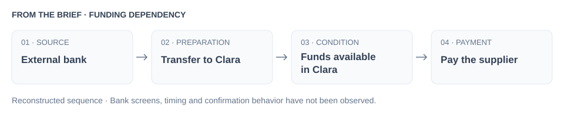

The diagram makes the dependency described in the brief visible. It does not document the external bank's screens, transfer time or the way the manager confirms that the funds arrived.

> **My reading · A1:** paying a supplier includes preparatory work before the payment itself. I want to understand how the manager coordinates that preparation and keeps track of the intended payment when moving between the bank and Clara. The extra step is explicit in the brief; its impact on effort, errors or abandonment still needs investigation.

**Question to investigate:** how much work does funding add, and what information does the manager need to resume the payment confidently once the money is available?

**Benchmark cross-check:** Mercury makes account identity visible in request and review; Wise distinguishes funding from transfer progress. These references help me investigate source clarity and continuity. They do not establish which external-bank capabilities Clara can offer.

> **Hypothesis to test · A1:** keeping the payment context and funding state understandable throughout preparation may help the manager resume the task with less reorientation. I would compare correct completion and active handling time, including funding preparation. This informs H1; it does not yet select a payment route or assume that Clara can remove bank authorization.

### A2 · Outcome labels carry more meaning than their shared color

**Evidence — Payments demo:** Paid and Reversed have green badges. Their text is different. The screen already provides statuses, search and receipt access.

**My assessment:** a quick scan by color may group a completed payment with a returned one. That is a visibility risk, not proof that people confuse them or that the screen fails accessibility. I would retain explicit labels and test how people interpret the outcomes.

**Benchmark cross-check:** Nubank's tutorial and Cora's historical animation pair an explicit result with amount, recipient and receipt access. Mercury instead confirms a request was created. The contrast is useful: completing a request and completing a transfer are different outcomes.

> **Hypothesis to test · A2:** distinct textual outcomes, supported by consistent semantic treatment and transaction detail, may help a person explain whether money moved and what to do next. This informs H2/H3; a new color palette alone would not establish the gain.

### A3 · A queue supports action, but decision context still needs inspection

**Evidence — Tasks demo and approval guide:** the queue exposes requester, amount, waiting time and an Approve action. The guide describes reviewing payment details and configured approvers. The individual approval detail is not captured.

**My assessment:** the queue makes pending work visible, which I would preserve. Repeated overdue labels may offer limited prioritization, but I cannot conclude that urgency rules are missing. Nor can I infer that the visible Approve action bypasses review.

**Benchmark cross-check:** Ramp exposes next-approver filtering; Conta Simples documents decision reasons and who acted and when. These support questions about responsibility and decision quality, rather than a justification for replacing Clara's approval engine.

> **Hypothesis to test · A3:** a clear next actor and a concise decision summary may reduce uncertainty about who acts and whether approval releases funds. This informs H2 within the payment flow required by the brief. I would first inspect the existing detail and ask a participant to explain the pending state.

### A4 · Existing validation is a foundation to preserve

**Evidence — official entry/error frames:** the form groups financial information and supporting documents; an invalid key has adjacent error text and prevents review.

**My assessment:** this already supports error prevention. The missing evidence is what happens after a valid lookup and how recipient identity, amount and source appear in review. Missing screenshots are not missing product features.

**Benchmark cross-check:** Mercury groups required and optional fields and shows local upload progress. Nubank exposes interpreted recipient details before the Pix action. Cora separates review from transaction authentication, although its visual reference is historical.

> **Hypothesis to test · A4:** adjacent feedback and a review hierarchy emphasizing recipient, amount and source may help people detect a mismatch without rereading explanatory blocks. This informs H4. I would keep Clara's existing validation behavior and measure errors caught, not simply clicks removed.

### A5 · Failure labels do not establish the recovery experience

**Evidence — Payments demo and official status documentation:** failure and processing states exist. A failure-detail screen and the uncertain-outcome recovery path have not been captured.

**My assessment:** I cannot claim Clara loses context or encourages duplicates. I can identify a consequential question: how does someone distinguish a definitive failure from an outcome that has not yet been confirmed?

**Benchmark cross-check:** Ramp documents reasons and available actions; Wise distinguishes funding and transfer milestones. Neither provides a direct visual precedent for every Pix failure in this case.

> **Hypothesis to test · A5:** preserving the request and offering a state-specific next action may support recovery without repeated entry or duplicate intent. This informs H3 within the same payment flow. Unknown outcomes need status verification before a new submission can be considered safe.

### A6 · Dense information needs hierarchy, not a cosmetic reset

**Evidence — supplied Summary, Tasks and Payments screens:** several summaries, statuses and actions compete within broad tables; some actions are icon-only. The Summary capture also shows horizontal overflow. Capture size and demo data may affect that layout.

**My assessment:** these are reasons to check scanning, responsive layout and action recognition. They do not establish insufficient contrast, absent tooltips, keyboard failure or poor real-world performance. I have not tested those behaviors in the authenticated product.

**Benchmark cross-check:** Ramp uses restrained list hierarchy and Mercury groups task fields. I would borrow their grouping principles while retaining familiar payment vocabulary and the existing company's controls.

> **My reading · A6:** the DS can make spacing, text roles, status treatment and interaction states predictable across my proposal. It cannot fix a funding dependency or make an unclear process understandable by itself. My visual direction is a case design choice; its value must be demonstrated through task comprehension and consistency.

### From audit to the brief's experience hypotheses

| Audit | Design responsibility | Hypothesis |
| --- | --- | --- |
| A1 | Replace the separate manual top-up task with understandable external-source payment initiation. | H1 · source and continuity |
| A3 / A2 | Preserve company policy and clarify each action's consequence. | H2 · commitment |
| A4 / A6 | Preserve validation and make payment review easy to check and correct. | H4 · review |
| A5 / A2 | Explain outcomes and retain the request for safe recovery. | H3 · recovery |

The benchmark informs interaction mechanisms for these hypotheses. All four belong to the single opportunity defined by the brief.

## Audit-driven interface decisions

| Audit finding | Shared design rule | Applied pattern |
| --- | --- | --- |
| A2 · Ambiguous status | Approval, processing and settlement have distinct labels; color supports the meaning. | PaymentStatus, Badge, Timeline |
| A3/A4 · Decision and validation context | Keep recipient, amount and source together. Errors stay beside their fields; correction retains unrelated values. | ReviewSummary, Field, InputGroup, Alert |
| A5 · Uncertain outcome | Preserve the request and offer a status check before another submission. | Wizard and service state model |
| A6 · Hierarchy and recognition | Group related information, label consequential actions and preserve visible focus. | PageHeader, Stack, Button |

The DS carries reusable presentation and interaction rules. Payment permissions and duplicate-submission guards belong to the state model and, in production, the backend.

## Payments as the entry point

**Demo screenshot.** The screen brings together Balance, Processing and Pending approval; Overview, Pending approval and Scheduled tabs; beneficiary search, filters and receipt download. Each row shows request date, beneficiary, document, amount, method, status and attachment.

The screenshot includes Pending, Paid, Reversed, Rejected and Failed. Paid and Reversed share the same green: the text distinguishes the outcome, but color does not distinguish settlement from a return. The monetary approval summary and tab count represent different measures, so the screenshot alone cannot establish an inconsistency.

> **Hypothesis to test:** starting the new flow from New payment could preserve accounts-payable context. The funding account would also need to appear in review and detail, so both requester and approver know where the funds will come from. The current screenshot has no bank-source column.

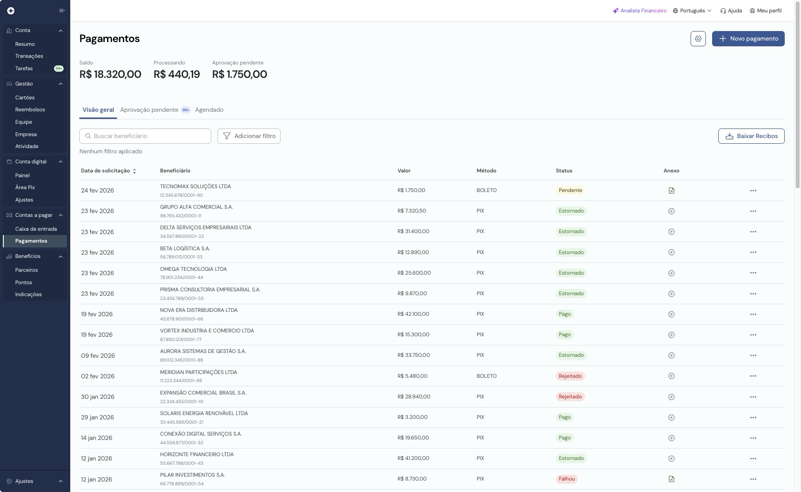

## Payment creation and validation

**Official documentation, article dated November 14, 2025.** The guide instructs users to open Accounts Payable → Payments → New payment, select Pix, enter a key or copy-and-paste code, look up the beneficiary and review the amount. Submission follows company approval rules. Documents are optional in this flow.

The form separates documents and financial information into two areas, with a total and actions in the footer. It also offers TED and Boleto; my case scope remains Pix.

### Official entry demonstration

The official GIF illustrates methods, identifiers, bank fields and validation. It does not establish the complete journey from review to execution.

### Observed error state

The error frame was extracted from the original GIF without redrawing: a red field border, invalid-key message and disabled Review button. It is an existing reference for an inline error. Authorization failures and an uncertain result at the external bank will require additional patterns.

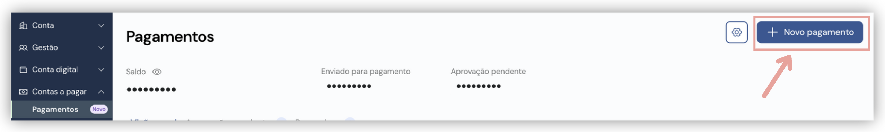

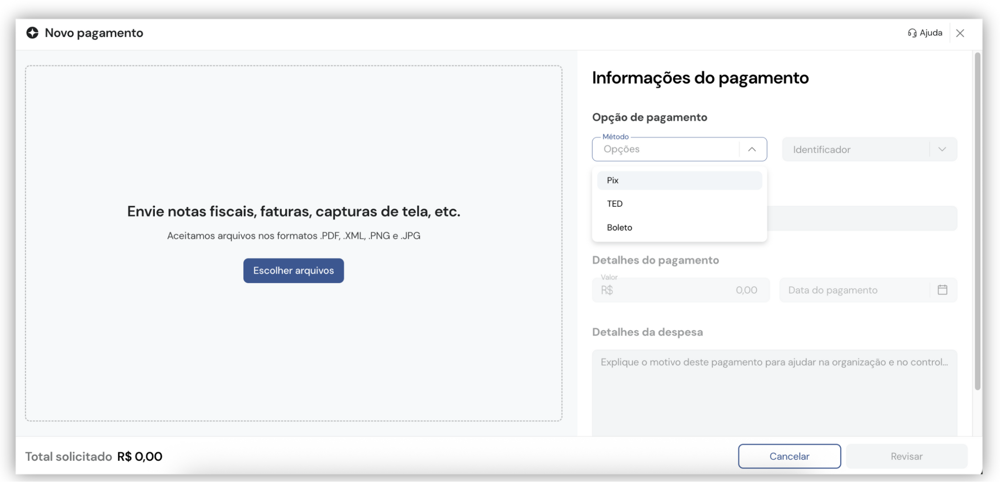

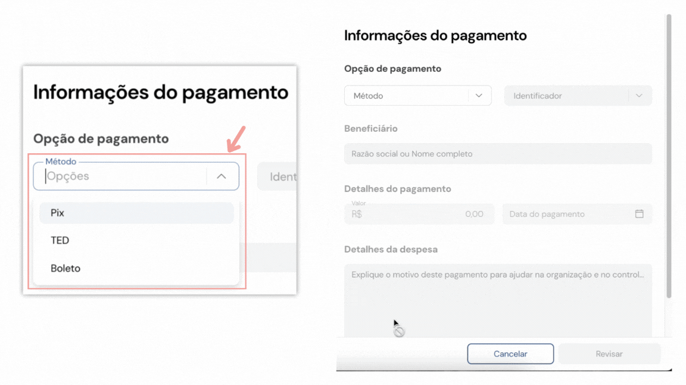

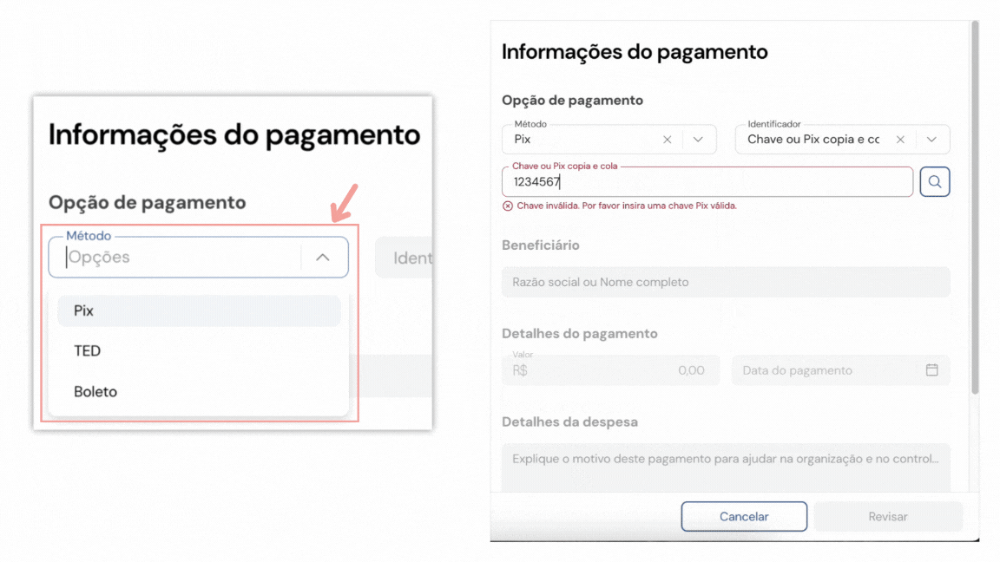

Sources: [New payment guide](https://ajuda.clara.com/hc/pt-br/articles/42531424668307-Como-fa%C3%A7o-um-pagamento-pela-Clara).

## Email code confirmation

**Official image.** The transfer guide, dated June 5, 2026, includes confirmation through a code sent by email before the approval workflow. The screenshot filename dates to October 2025.

The image shows five code positions, resend with a countdown, help, Back and edit, and Confirm. This authenticates the operation within Clara; it is neither confirmation that a request was recorded nor authorization at the external bank. I still need to validate whether every role and method requires it.

Sources: [Digital Account transfer guide](https://ajuda.clara.com/hc/pt-br/articles/27623979963027-Como-realizo-transfer%C3%AAncias-e-pagamentos-de-boletos-atrav%C3%A9s-da-Conta-Digital-da-Clara).

## Approving a request

The guide says that an approver opens a pending request, reviews beneficiary, amount, key, bank details and approvers, and approves or rejects it. Execution depends on the final approval. The June 2025 article points to Management → Payments; the demo and later guide use Accounts Payable → Payments. I am using the demo as the visual reference for the proposed navigation.

**Visual gap:** this collection has no approval-detail screenshot. The Tasks image shows a queue and actions, but it does not establish that Approve records a decision without an intermediate review.

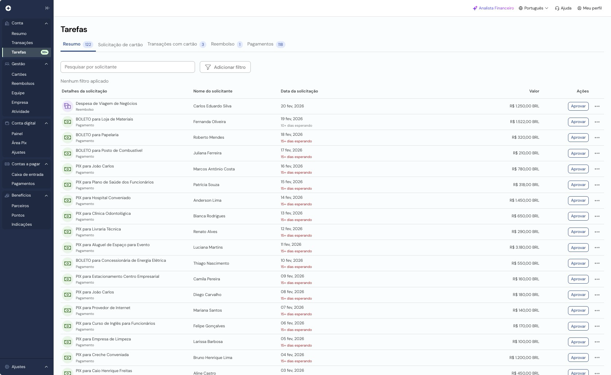

Sources: [Payment approval guide](https://ajuda.clara.com/hc/pt-br/articles/41962561308947-Como-aprovo-ou-reviso-pagamentos-na-Clara).

## Approval workflow configuration

**Official documentation, article dated November 14, 2025.** The Payments settings control opens Approval workflows. Images show workflow creation, conditions and actions for automatic approval, automatic rejection or adding approvers. The guide allows up to five layers. I identified this mechanism as an existing dependency for the proposal.

The official supporting PDF describes the same journey and default rule. Its footer indicates 2024; the article date does not make the embedded images a 2025 or 2026 UI.

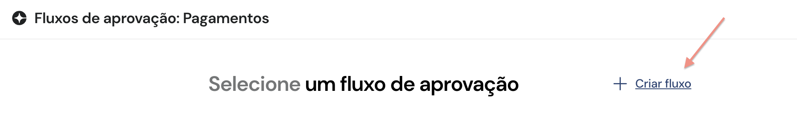

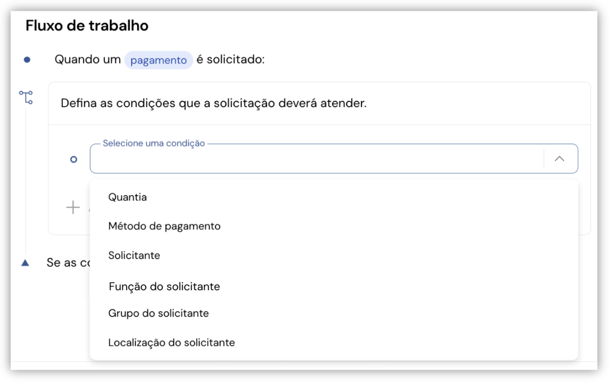

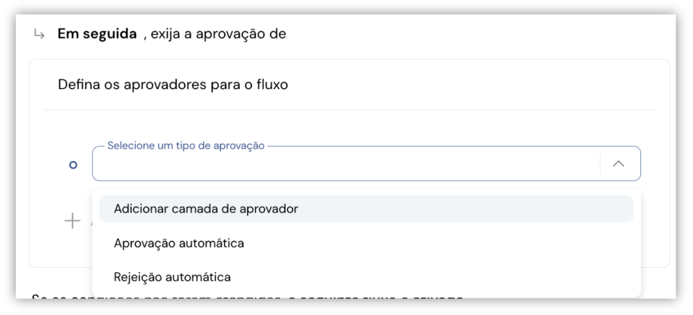

Sources: [Approval configuration guide](https://ajuda.clara.com/hc/pt-br/articles/41962086294291-Como-crio-um-fluxo-de-aprova%C3%A7%C3%A3o-de-pagamentos-na-Clara), [Official supporting PDF](assets/14-guia-aprovacoes.pdf).

## Existing execution and failure states

The documentation describes completed payment, reversal, scheduling, pending approval, rejection, cancellation, validation and failure. Failure causes include balance, limits, beneficiary details, account restrictions and security. The current guide also instructs users to check the debit in the Clara account statement.

> **My reading for the proposal:** an external-bank debit needs visible confirmation and source traceability. The Clara statement alone does not represent that debit. The list should distinguish internal approval, bank authorization, processing and final outcome.

### Processing observed in the demo

I captured the Arc demo session at step 14. The crop preserves navigation and the processing row while excluding the browser sidebar. The observed row is a boleto: it establishes the presentation pattern, rather than the duration or processing behavior of a Pix payment.

### Status badges published by Clara

The source provides images for Paid, Reversed, Scheduled, Pending approval, Rejected, Canceled, Processing and Failed. These badges come from the status guide; they are not screenshots of each payment's detail view.

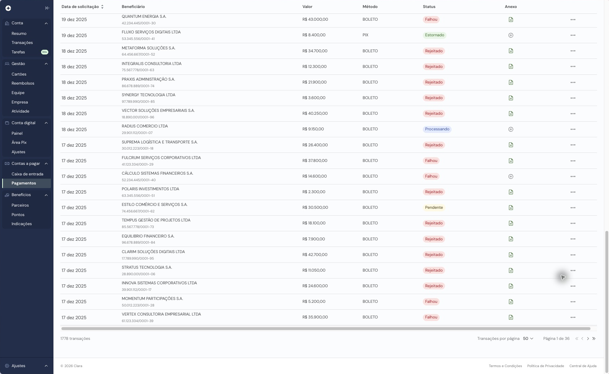

Sources: [Payment statuses and failures](https://ajuda.clara.com/hc/pt-br/articles/44280296702611-Quais-os-status-dos-Pagamentos-na-Clara).

## Pix receipt and transaction traceability

**Official image, article dated October 28, 2025.** The Digital Account panel allows opening a transaction and downloading its receipt. The identifier is also present in the downloaded document.

The panel shows date and time, method, recipient details and a Source section with name, document, institution, branch and account. The ID and download action appear at the end. Clara's original image already masks the data. It covers the receipt panel; I did not obtain the final PDF.

The functionality guide, updated in June 2026, confirms downloadable Pix and boleto receipts. An ID identifies the transaction, but does not by itself establish a decision history with authors and timestamps.

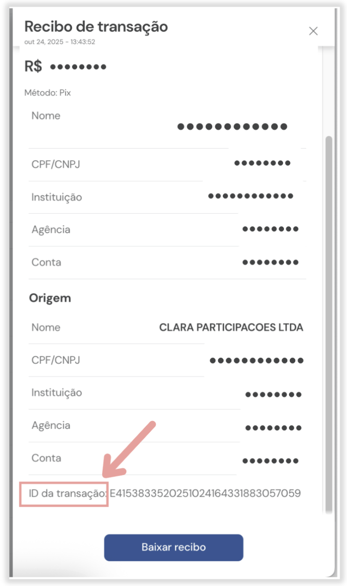

Sources: [Transaction ID guide](https://ajuda.clara.com/hc/pt-br/articles/46019394818195-Onde-encontro-o-ID-da-transa%C3%A7%C3%A3o-transfer%C3%AAncia-na-Clara), [Digital Account features and receipts](https://ajuda.clara.com/hc/pt-br/articles/33945288232979-Quais-as-funcionalidades-e-comprovantes-da-Conta-Digital-da-Clara).

## Suppliers in the 2026 documentation

The June 1, 2026 guide describes a Suppliers module in Accounts Payable. Payment uses Pix transfer, supplier selection, automatically populated details, amount, immediate or scheduled submission and Send for payment. Supplier detail includes a history of paid transactions.

The article documents this journey in text without images. Suppliers does not appear in the demo navigation I consulted. I consider it a variant to investigate; I will not replace the captured form as if both belonged to the same version. Supplier payment history and a request's approval history are different evidence.
Sources: [Suppliers guide](https://ajuda.clara.com/hc/pt-br/articles/52075103095827-Como-cadastrar-e-pagar-seus-Fornecedores-atrav%C3%A9s-da-Clara).

## Operational volume and batch Pix

The documentation allows CSV/XLSX upload with up to 250 payments, key validation, an approval workflow and individual outcome reporting. Users can save and review later.

**My initial scope:** starting with one payment lets me investigate flow dependencies before adding complexity. The persona still requires a discussion of how source, consent and failure behave at volume. Existing batch Pix in Clara does not establish equivalent batch support through Open Finance.
Sources: [Batch Pix guide](https://ajuda.clara.com/hc/pt-br/articles/45470603860371-Como-realizo-pagamentos-via-Pix-em-lote-na-Clara).

## Other demo screens

### Account overview

Credit, transaction balance, flexible limit and activity provide references for hierarchy and resource distinction. This screen does not show available money at external banks.

### Card transactions

The structure focuses on cardholders, cards, evidence and expense review. It is a table and status reference; the supplier journey belongs in Payments.

### Digital Account

The page offers financial actions and a statement. Transaction balance and flexible limit are distinct. Connecting an external bank account should not combine its funds with the Clara balance without explaining the source.

### Pix area

This screen organizes keys and Pix actions. It can provide interaction patterns, while supplier payments also involve requests, approvals and tracking in Accounts Payable.

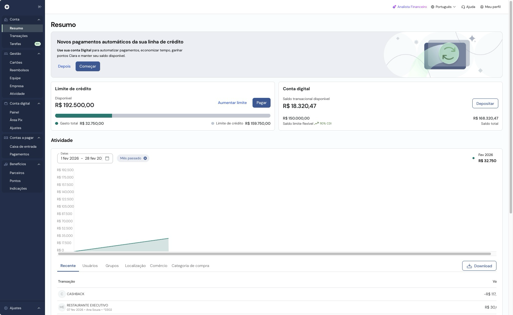

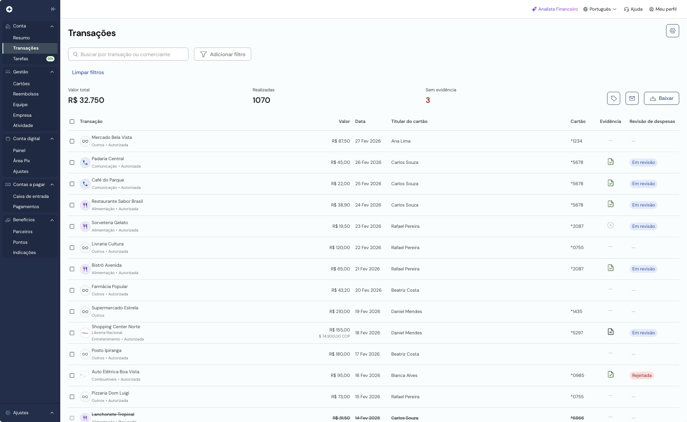

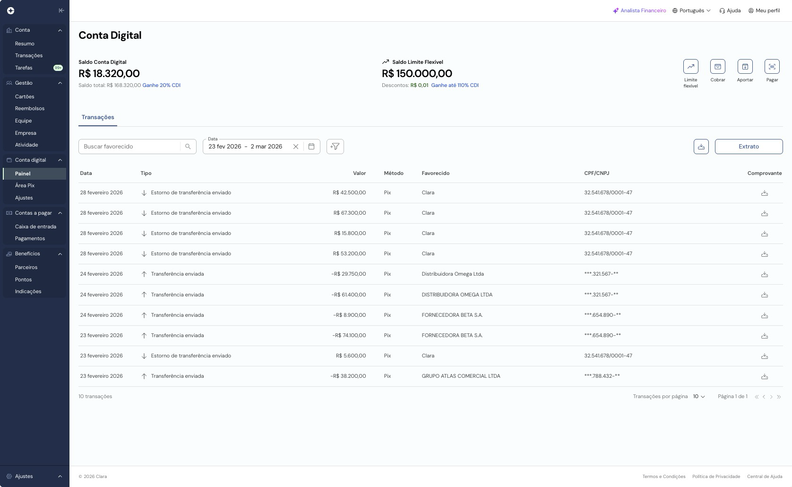

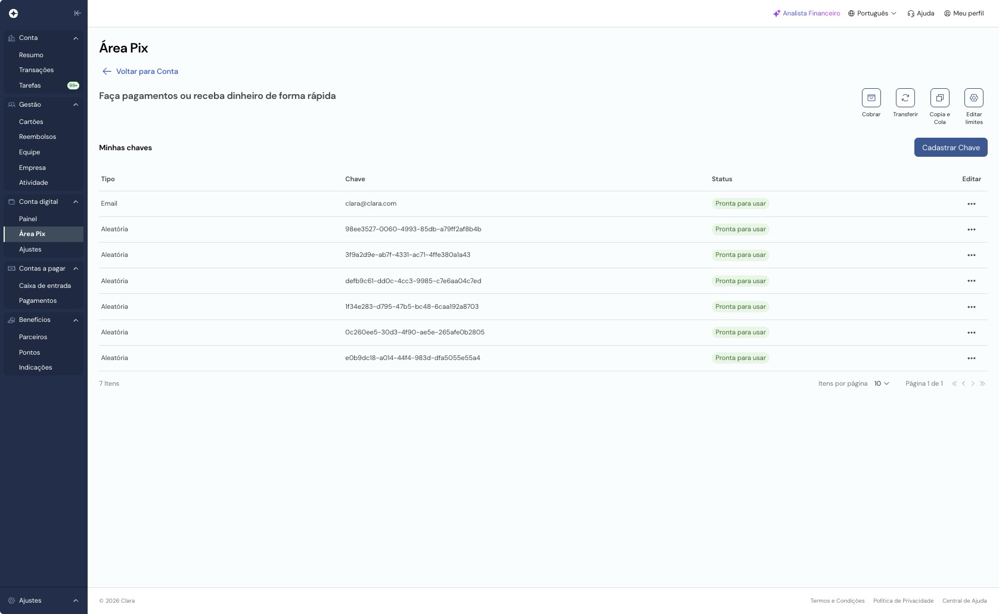

## Reference recency

The public releases I consulted during the initial research list Accounts Payable and batch Pix in March 2026, and accounting fields in August. I treated these as evidence of features and public communication, without assuming they visually replace the demo screens.

The Brazilian public tour linked from Clara's official site uses the same navigation structure on the opening screen I consulted. Its full journey requires registration. Help Center images complement the demo, but I did not classify them as visually newer than it.
Sources: [Public releases](https://www.clara.com/pt-br/recursos/lancamentos), [Public demo](https://app.supademo.com/demo/cmm97tev664tqdtfhc3gb0vt5).

## State coverage and reconstructions for validation

| Requested state | Real evidence | Visual coverage |
| --- | --- | --- |
| Validated beneficiary | Creation and Suppliers guides describe identification and entry | Separate diagram; populated form not captured |
| Review before submission | Review button and written description | Separate diagram; summary not captured |
| Request confirmation | Confirmation code captured, without evidence of final registration | Separate diagram; code and registration are distinct states |
| Approval detail | Fields, approvers and actions described | Separate diagram; detail not captured |
| Processing payment | Boleto row in demo and official badge | Real list screenshot; detail not captured |
| Failure detail | Failed rows and documented causes | Separate diagram; on-screen message not captured |
| Final receipt | Official Pix receipt panel with ID and download | Real panel screenshot; final PDF not obtained |
| Audit history | Transaction ID and supplier history documented | Reconstructed timeline; decision history unverified |
| After final approval | Guide describes forwarding to processing | Documented rule; live sequence not observed |

The Arc demo session shows the list at step 14. During inspection, New payment and a Failed row did not open their details, so these clicks added no evidence of the internal flow.

The reconstruction gallery contains seven low-fidelity diagrams with fictional data. Each image carries an identification banner. Inferred fields, order and actions remain explicit; this is neither a confirmed reproduction of the UI nor the Open Finance proposal.

**Final approval:** the source describes execution after all approval layers are completed, which does not guarantee immediate settlement. The transition, processing interval and failure recovery still need observation.

**Audit:** September 2026 documentation confirms an activity timeline for cards, rather than Payments. It can inform a discussion about reuse, but I did not classify it as supplier-payment audit evidence.
Sources: [Reconstruction gallery](reconstrucoes.html), [Payment approval guide](https://ajuda.clara.com/hc/pt-br/articles/41962561308947-Como-aprovo-ou-reviso-pagamentos-na-Clara), [Card activity guide](https://ajuda.clara.com/hc/pt-br/articles/55396213827731-Como-verificar-quem-alterou-um-cart%C3%A3o).

## AI work log

I used Codex as a working partner across research organization, interface exploration, implementation and verification. My role was to set the direction, review what appeared on screen and decide what needed to change. This log records concrete iterations from the case; it does not imply that I manually wrote every line of assisted code.

### Start from the assigned problem

I supplied the brief and screenshots from the Clara demo. AI helped organize observations, consult official sources and prepare reference material. When the opportunity framing expanded beyond the assignment, I brought it back: paying suppliers with funds at another bank was already defined in the brief. The design work was to make that service understandable within Clara’s existing operation.

An additional AI review challenged the opportunity tree and recovery claims. I used that critique to refine the framing, then corrected it again against the brief. The resulting H1–H4 remain hypotheses, not findings from user interviews. Captured screens and reconstructed diagrams are identified separately in the evidence.

### Keep the existing product in view

I asked for a new-payment entry that acknowledged both Clara balance and the proposed external account. AI implemented iterations; I rejected the separate choice modal and oversized options, then directed a compact popover anchored to New payment. I also asked for Pix key recognition, an explicit paste action and QR scanning as a simulation, without opening a real camera.

The same review applied to navigation: I asked to preserve the existing product structure, expose only implemented destinations and make approval actions reachable after removing the separate pending page. These were behavior decisions to verify in the prototype, not just changes to labels.

### Judge the interaction, not only the implementation

The mobile table was technically present but difficult to use. I called out the density and controls and asked for a composition suited to mobile. AI assisted with the implementation of readable payment rows and the accompanying controls.

I also directed the branded loading: a brief transition with the page visible through transparency and blur. My intention was perceived care and continuity before entering important financial details. AI initially focused too heavily on technical caveats; I redirected the explanation toward that human intention. Placement, duration and repeated loading required further visual review.

The decision trace in **Design and engineering contributions** connects these interventions to hierarchy, progressive disclosure, user control and emotional design. This log records how AI participated in that work.

### Turn corrections into reusable implementation

I approached the foundation through composition: tokens and basic controls establish the vocabulary; combined fields, review summaries and wizard patterns carry it into the task. That is the atomic-design reasoning behind my insistence on shared styles and behaviors, rather than a separate visual solution for every screen.

I asked for clean English code, stronger use of the shared DS API and automated interaction coverage. AI assisted with component work, the move from Lucide to Phosphor, refactoring and tests. The shared source, component catalog and executable examples let a reviewer inspect how the design is represented in code.

I requested end-to-end coverage for entry, approval, authorization and mobile. Type checks, build checks and browser tests were run during development. They did not replace my visual review: I still found inconsistent spacing, broken hierarchy and unreadable contrast after automated checks passed. Passing tests establish only the behavior they cover.

### Direct the showcase as a designed experience

I provided my Mercado Livre case as a reference for storytelling and presentation. Early AI versions accumulated unrelated cards, diagrams and text. I asked for a separate showcase, a clearer narrative, selective dark surfaces and larger alternating screenshots. I then reviewed specific details: shared image captions, the relationship between live components and their code, and the placement of AI notes beside each chapter.

Those corrections shaped both the page and the way this work is presented. AI produced implementations; I assessed whether they communicated the intended story and asked for revisions when they did not.

### Tools, instructions and implementation constraints

Codex assisted with research organization, implementation, refactoring and verification. An Astra review challenged the opportunity framing, recorded in commit `ab4a7dc0`. My instructions, in the conversation and browser comments, repeatedly redirected the result: move source choice beside New payment; preserve mobile queue behavior while changing composition; use a shared DS API; and test entry, approval, authorization and recovery end to end. These are summaries of the instructions, not fabricated verbatim prompts.

[`DS_CONTRACT.md`](https://github.com/nanag-carvalho/clara-product-finance-case/blob/main/central/DS_CONTRACT.md) records hierarchy, spacing, component states, accessibility behavior and reuse constraints. The registry and `ds:check` make parts of that contract executable. There is no project `CLAUDE.md` or `AGENTS.md` in the reviewed repository; the recorded conversation, contract and checks are the relevant evidence. A personal voice skill was used for presentation editing, not as a source of financial requirements.

My direct work was setting the direction, comparing alternatives and inspecting the actual output, including mobile navigation, contrast, image proportions and transitions. Code changes were AI-assisted. The record does not establish a separate manual Figma or coding pass, so I do not attribute one to myself.

### Retrospective time estimate and its basis

The work spans October 13–14, 2026. These are approximate **elapsed phase windows** reconstructed from commit milestones and the conversation, not tracked active hours. Research, design, coding and review overlap; a batch commit does not reveal how much time each activity took.

| Recorded phase | Approximate window | Basis and limitation |
| --- | --- | --- |
| Initial foundation | October 13 evening; duration unknown | First commit at 20:38 (`3eca7ad3`) already contains the hub and DS; preparation predates it. |
| Research, framing and flow refinement | About 2 hours on October 14 | 09:38–11:47, `f9246f27` to `b1922326`; includes design iteration. |
| Prototype, DS and story iteration | About 6 hours | 11:47–18:06, ending at `ad4b171c`; mixed work recorded in a batch delivery, not six isolated hours of coding. |
| Final review, fixes and release | About 40 minutes | 18:06–18:43, through `9d3325eb`; verification also occurred earlier. |
| Presentation and subsequent refinements | Continued afterward | Separate ongoing work; excluded from the windows above. |

Commit times use São Paulo time (UTC−03:00). The overnight gap is not counted as continuous work. These windows do not establish total active effort or time saved by AI.

### Evidence and limits

The prototype, DS catalog and repository tests are the implementation evidence. Browser comments and this log record my interventions. The retrospective windows above provide a qualified estimate; active time and AI savings were not measured. No user interviews, usability outcomes or business impact are claimed. The financial services, bank responses and camera interactions remain simulated.

## Desk research: three relevant references

I limited this desk research to three references: Conta Simples as a closer Brazilian expense-management alternative, Cora as an adjacent Brazilian business-account product, and Ramp as an international accounts-payable benchmark. They are not equivalent competitors in every market. I consulted public material on October 13, 2026; I did not test their authenticated products or compare completion rates.

| Reference | What the official source establishes | What I would bring to this case | Boundary |
| --- | --- | --- | --- |
| Conta Simples | Transfer requests can be approved, rejected or edited; history and batch payments are described | Preserve company control while reducing operational steps | Public product communication does not prove an external-account initiation journey |
| Cora | Its boleto guide separates entry, payment review and a transaction-password step | Make review and authorization distinct, with a clear next action | This is a mobile boleto journey, not evidence of Pix Open Finance or enterprise approval layers |
| Ramp | Bill documentation separates drafting, approval, payment and history; failure detail provides a reason and next steps | Organize working queues around actionable stages and retain recovery context | International payment mechanisms and permissions cannot be transferred directly to Brazil |

My takeaway is that centralization alone is not the differentiator I should design for. The brief's stronger opportunity is continuity between the work organized in Clara and funds held elsewhere. Approval and recovery patterns can support that continuity, but they do not establish Brazilian bank eligibility or user demand.

Sources: [Conta Simples banking services](https://contasimples.com/servicos-bancarios), [Cora payment guide](https://www.cora.com.br/ajuda/artigo/como-realizar-um-pagamento-no-aplicativo-da-cora/), [Ramp bill lifecycle](https://support.ramp.com/bill-lifecycle/), [Ramp approvals](https://support.ramp.com/bill-pay-approvals/).

### Conta Simples: request, decision and history

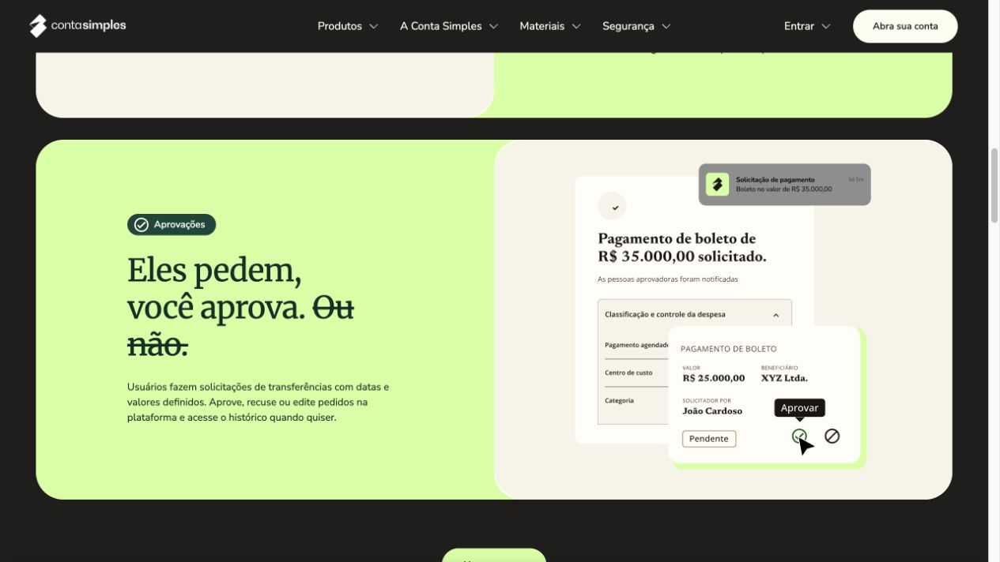

**Evidence:** official commercial illustration, captured October 14, 2026. It shows a requested-payment confirmation behind a pending item with amount, beneficiary, requester and decision controls. The two cards display different amounts; I treat them as illustrative examples, not a continuous transaction or an authenticated product capture.

**What I take into the case:** H2 needs a request state that names the next responsible actor. A success icon must not imply settlement when the action only created a request. I would use labelled decision actions rather than rely on unexplained icons.

The [approval guide, updated April 8, 2026](https://ajuda.contasimples.com/hc/pt-br/articles/27812960748571-Guia-de-Aprova%C3%A7%C3%B5es-Gerenciamento-de-Solicita%C3%A7%C3%B5es), documents detail review, permissions, rejection reasons and history showing who acted and when. The [payment-request guide](https://ajuda.contasimples.com/hc/pt-br/articles/37694660155931-Solicita%C3%A7%C3%B5es-de-pagamentos-e-transfer%C3%AAncias-Pix-TED-e-boletos) distinguishes the requester from the company approver. These support the workflow interpretation; they do not verify the illustrated layout or external-bank initiation.

Visual source: [Conta Simples banking services](https://contasimples.com/servicos-bancarios).

### Cora: review, authorization and outcome

The following stills come from the animation embedded in Cora's official payment-help article. **Historical reference:** the interface shows 2020 dates, the source is only 270 × 480 pixels, and its capture/publication date is not stated. The article discusses boleto payment while the animation labels the task as a transfer. I use only the visible interaction sequence, without treating it as today's Pix flow.

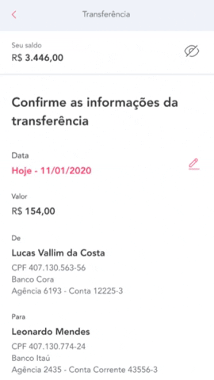

**Review · H1/H4:** source and destination are explicit before commitment. I will test whether the person identifies the debit account and catches a mismatch. The dense bank details are a reason to explore clearer hierarchy, not copy the screen unchanged.

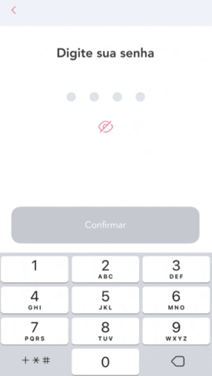

**Authorization · H2:** review and authentication are distinct. This is Cora's own authentication UI; it does not establish what Clara can display or customize during an external-bank handoff.

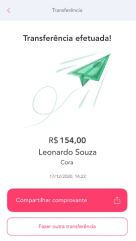

**Outcome · H2/H3:** the result keeps the transaction recognizable and exposes the receipt. The sample recipient differs across the source animation, so this is pattern evidence rather than proof of an internally consistent end-to-end transaction. Recovery and uncertain outcomes are not shown.

Sources: [Cora payment-help article](https://www.cora.com.br/ajuda/artigo/como-realizar-um-pagamento-no-aplicativo-da-cora/) · [Original animation](https://corastatic.com/boto/0902.09-SsKnR.gif). Inspected October 14, 2026.

## UI references and design criteria

I inspected the publicly documented Ramp approval-list image below. Its restrained surfaces, line tabs, aligned amount column and visible next approver make it a useful working-interface reference. That is my visual judgment, not a measured usability result. The row includes a 2024 date; the image does not establish the newest authenticated UI.

The same guide publishes a draft-detail reference. I would use these screens to compare list/detail organization and action placement, while preserving Clara's navigation and the case DS.

My interface criteria are compact productive typography, a neutral Slate palette, visible funding source, one primary action per stage and separation between approval and payment outcome. Modern appearance should support comprehension and trust. I will reuse the existing DS rather than introduce another visual language.

Source: [Ramp bill lifecycle and original images](https://support.ramp.com/bill-lifecycle/). These are external visual references, not additions to the observed Clara journey.

## Interaction benchmark: Mercury, Nubank and Wise

I refined the interaction benchmark after comparing the Mercury screenshots supplied for this case with official Nubank and Wise guidance. This complements the three competitor references; it does not expand the feature scope. The evidence types matter: I inspected supplied Mercury screenshots, official Ramp documentation images and frames from an official Nubank tutorial. Wise remains a documented behavior reference; I have not verified its current interface.

| Reference and evidence | What I can support | Interpretation for my proposal | Limit |
| --- | --- | --- | --- |
| Mercury · supplied Mobbin screenshots, capture date unknown | Named steps at the side; form sections; account identity inside the selection; optional attachment with upload feedback; amount emphasized in review; success names the created request. | Let grouping, account identity and field-level feedback do more of the instruction. Use an explicit result rather than a generic success message. | This creates a collection link using ACH/wire, not an outgoing Pix. A created request is not a settled payment. |
| Nubank · official Pix guidance, reviewed October 14, 2026 | Recipient and transaction data are reviewed before confirmation. | Make verified recipient identity and amount prominent before commitment; keep instructions close to the relevant decision. | I have not inspected the latest logged-in app. This does not demonstrate company approval or Clara's bank-initiation capabilities. |
| Wise · official sending guide and tracker, reviewed October 14, 2026 | Recipient, amount, payment method, review and tracking are separate concerns. Method information includes fees and timing; tracking distinguishes funding received from money sent. | Show consequences when choosing a source and use precise tracking milestones after submission. | International transfer rails and timing differ from Pix. Wise's sent status does not necessarily mean the beneficiary has received funds. |

### Mercury: observed interaction sequence

The screenshots show a broader task workspace rather than an isolated small modal. I should compare the container against task length and navigation needs instead of treating a dialog as the improvement itself. Their useful pattern is the structure: form → review → explicit outcome. I am not importing their payment rails, brand treatment or optional features into this Pix scope.

### Visual evidence: task feedback in Mercury

These three additional supplied Mobbin captures complete the attachment sequence. Capture date is unknown; the images retain the original attribution. Click any image to enlarge it.

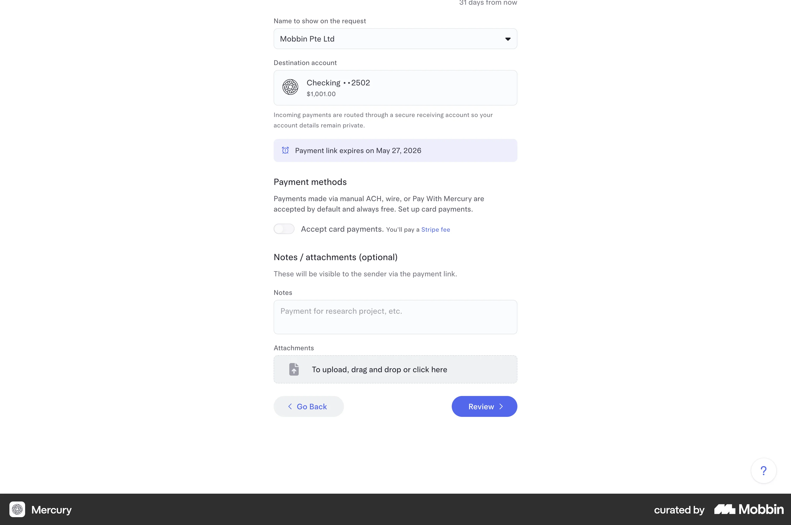

> **My reading:** optional content sits after the required decision fields, with navigation at the end of the form. For H4, I will keep supporting information secondary to recipient, amount and source. Attachments remain outside the core experiment.

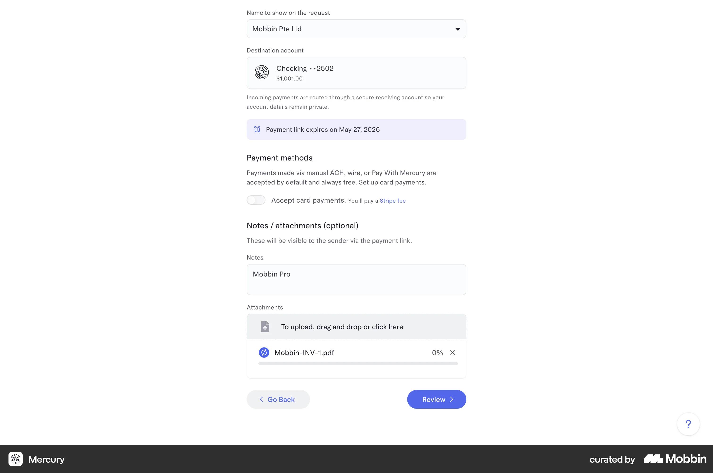

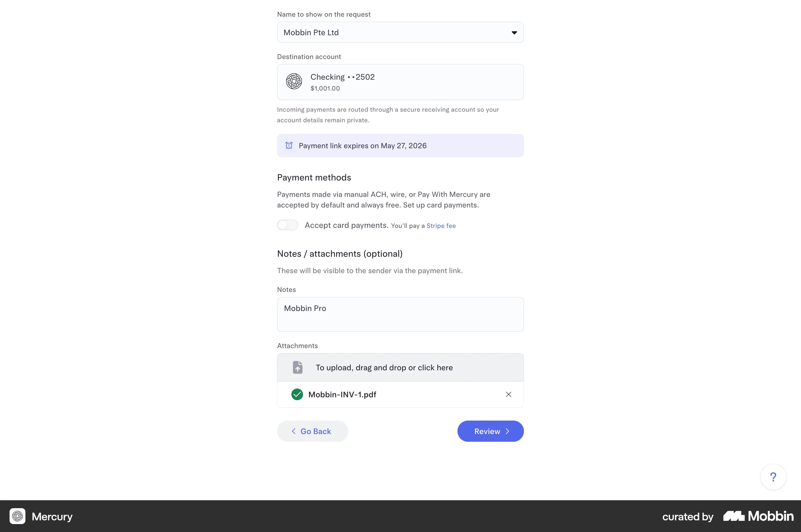

> **My reading:** feedback changes beside the object being processed, without replacing the task. I will apply that principle to recipient lookup and service responses: retain context, announce the state and prevent repeated submission. An upload completion check is not evidence that a financial transaction completed.

### Visual evidence: Nubank Pix, from entry to receipt

I captured the following frames from Nubank's verified YouTube channel, **“Como fazer um Pix usando áudio e texto?”**, published May 22, 2025, inspected October 14, 2026. This is a public demonstration of a conversational Pix experience, not a session in the current app. The review screen itself describes the experience as being tested.

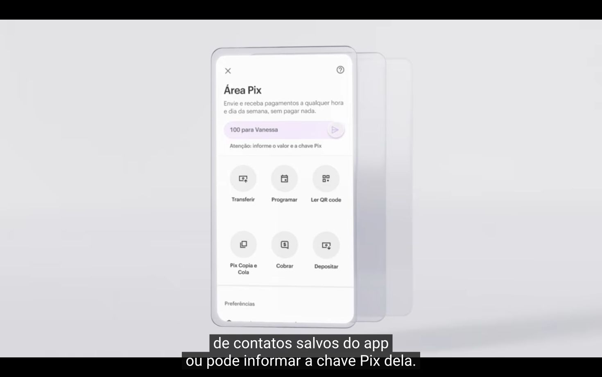

[Watch the entry at 00:30](https://www.youtube.com/watch?v=e7qt92GdEWo&t=30s). **My reading:** instruction appears next to the input. For H4, guidance belongs near the field that needs it. I will not add conversational AI to this case.

[Watch review at 00:40](https://www.youtube.com/watch?v=e7qt92GdEWo&t=40s). **My reading:** interpreted input is exposed for checking before commitment. H4 should test whether a person catches a wrong amount or recipient; a shorter flow alone does not establish safer review.

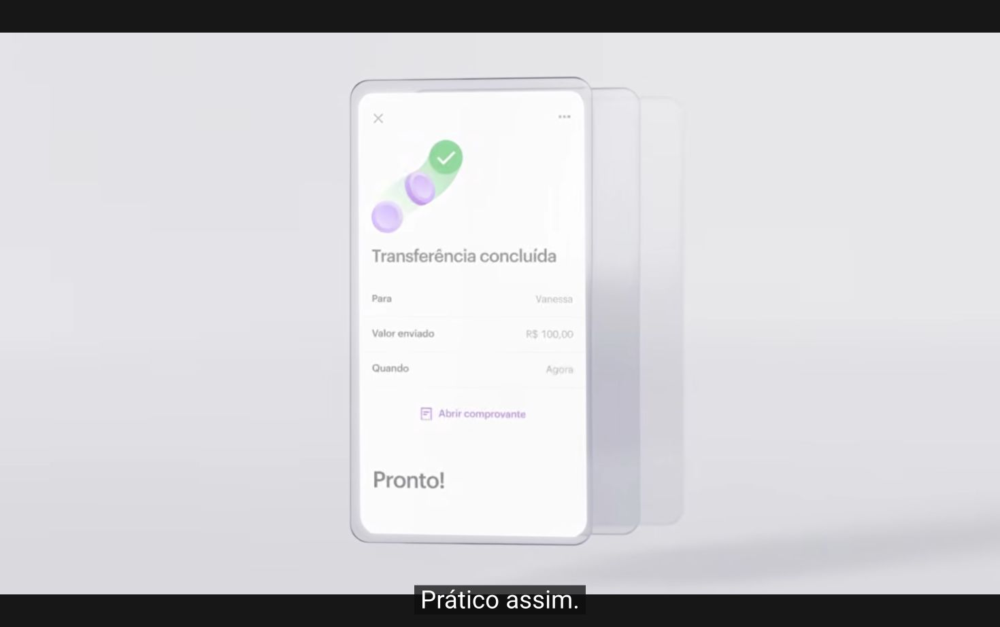

[Watch the result at 00:50](https://www.youtube.com/watch?v=e7qt92GdEWo&t=50s). **My reading:** the result names the outcome and retains transaction context. For H2/H3, Clara needs equally precise distinctions between approval, processing, uncertainty and settlement. The completion treatment must only appear after confirmed success. Personal Pix does not establish corporate approval or external-bank capabilities.

### Visual evidence: returning to work in Ramp

Official help-center images, collected October 14, 2026; visible example dates are from 2024. The red callouts are part of Ramp's source image. They document an interface example, not a verified latest release.

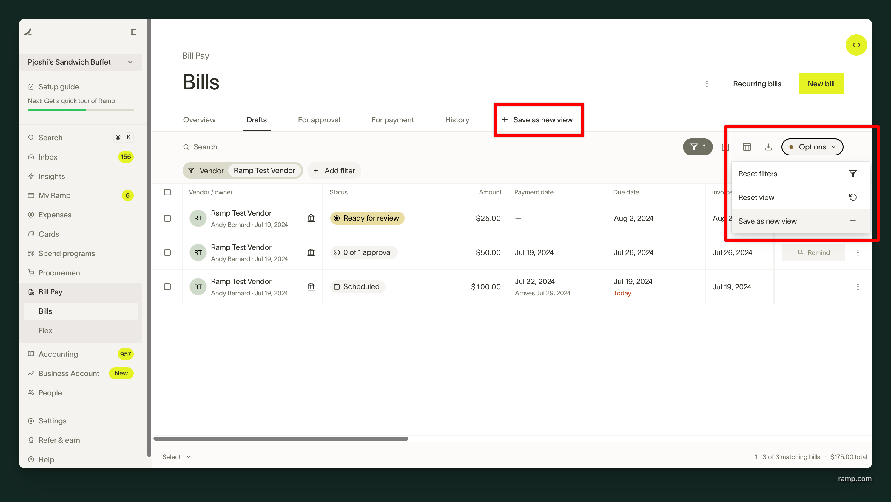

> **My reading:** a task can return to a recognizable queue. For H2/H3, closing the guided payment should leave a findable request with its current state. Saved custom views are a future reference, not part of this two-day scope.

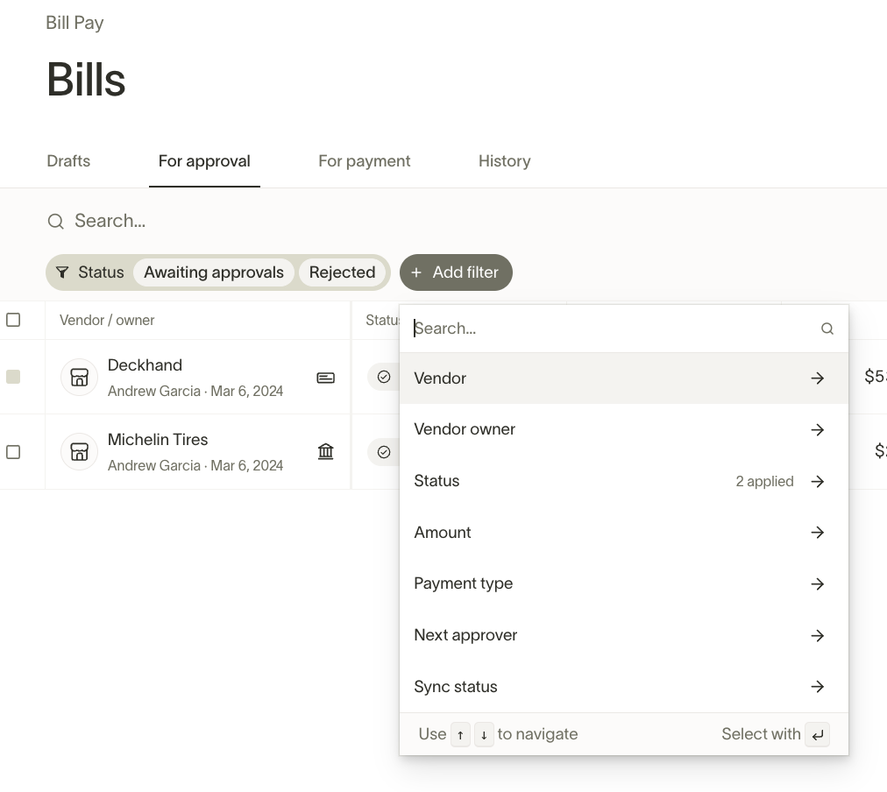

> **My reading:** status and responsibility can help locate work without rereading every row. I will test a named next actor in the payment detail before considering advanced filters.

Source: [Ramp — managing bills and payments](https://support.ramp.com/managing-bills-and-payments-on-bill-pay/).

### What this evidence supports — and what remains open

| Decision to explore | Visual anchor | Hypothesis / check |
| --- | --- | --- |
| Keep guidance beside the decision | Nubank entry; Mercury grouped form | H4: fewer rereads without missed errors. |
| Keep source identity visible during preparation and review | Mercury selected account in the existing request/review captures | H1: identify the account that will be debited. |
| Preserve the object while its state changes | Mercury upload sequence | H3: retain payment context during lookup and recovery. |
| Distinguish task completion from money movement | Mercury request-created result versus Nubank transfer-completed result | H2: correctly explain whether funds moved. |
| Return to a findable item after leaving the task | Ramp queue and filters | H2/H3: locate the request and identify the next action. |

These are design mechanisms to test, not evidence of measured gains. Wise's sending and tracking guides remain useful for service-state semantics, but the public PDF I inspected contains explanatory material rather than detailed flow screenshots. I have not presented it as visual proof. External-bank authorization, unknown outcomes and failure recovery still need direct evidence; the prototype marks these service boundaries explicitly.

### What the current proposal needs to improve

I repeated technical explanations across connection, review and authorization. The source route, summary and alerts also repeat some information. A five-phase indicator currently combines preparation, an asynchronous company decision, a bank handoff and payment tracking; these are service states, not five equivalent form steps. I need to make the user's next action the organizing principle.

My next design iteration explores three task groups: **prepare the payment**, **review and request approval**, and **authorize and track**. A pending company approval belongs to an explicit status with a named responsible person. The bank handoff identifies the destination and the transaction being authorized. Payment tracking can continue after closing the task. The one-time preparation of an external account remains conditional on the provider journey, rather than an assumed extra consent for every payment.

The interface should instruct through a named account, verified recipient, amount emphasis, adjacent validation and an action naming its consequence. Longer service explanations move to optional details. Information required for consent and review remains visible at the point of commitment. Progress and confirmation support orientation; I have no evidence that rewards or gamification would improve this financial task.

### Refined hypotheses and controlled experiments

The opportunity is fixed by the brief. H1–H4 test mechanisms within that experience.

| ID | Refined hypothesis | Controlled comparison | What I observe | Evidence that challenges it |
| --- | --- | --- | --- | --- |
| H1 · source decision | A named source with its route supports the correct funding decision without searching another view. | Same supplier and amount with named source versus the previous summary. Keep the payment path constant; compare A/B separately as service alternatives. | Completion, active time, switching and identified debited account. | Source confusion or unnecessary navigation. Service eligibility is assessed separately. |
| H2 · next action | A concise status naming the responsible actor and action lets the person distinguish company approval, bank authorization and payment completion. | At the same service state, compare the earlier explanation-heavy prototype with a concise actor/action version. | Ask who acts next and whether funds have moved; record unprompted answers. | Approval is still interpreted as payment, or the next actor remains unclear. |
| H3 · recovery | A retained request with distinct actions for definitive failure and uncertain outcome supports resumption without repeated entry or duplicate intent. | Use separate interruption and unknown-outcome tasks. Preserve the same transaction data. | Re-entered fields, chosen recovery action and intention to submit again. | Lost context, unsafe retry or an unclear current state. |
| H4 · decision clarity | Emphasized amount and verified recipient, a named source account and adjacent field feedback help detect a planted review mismatch with less rereading than repeated explanatory alerts. | Compare the earlier prototype review with a compact decision-focused version; keep the service path and data constant. Include one intentionally incorrect amount or recipient in the test task. | Whether the mismatch is caught before requesting approval, details identified and rereading/hesitation. | More missed mismatches or faster completion caused by skipping review. |

In two days H1 tests the funding decision, H2 the meaning of commitment and H4 review correctness; H3 is a required recovery check; initiation eligibility is a separate implementation dependency. If sessions are unavailable, I report a heuristic evaluation and an experiment plan, not validated hypotheses. I use formative observations rather than inventing targets such as a 30% improvement.

Sources: [Mercury payment-link guide](https://support.mercury.com/hc/en-us/articles/44220096132116-How-to-create-and-send-a-payment-link-in-Mercury), [Nubank Pix guidance](https://blog.nubank.com.br/pix-tudo-sobre/), [Wise sending guide](https://wise.com/help/articles/2977959/how-do-i-send-money-with-wise), [Wise tracker](https://wise.com/help/articles/2452305/how-do-i-check-my-transfers-status), [Wise Platform status semantics](https://docs.wise.com/guides/product/send-money/tracking/transfer-statuses).

### Apple Wallet: prepare an instrument, then use it

Apple’s setup guide separates adding a supported debit or credit card, verification with the issuer where required, and subsequent use. I use that interaction model to explore two connected tasks: prepare an account in Accounts, then select it for a supplier payment. The visual cues I adapt are a recognizable account tile, masked identifier, explicit readiness and one setup decision at a time.

For Clara, the proposed account tile represents an external business account. Connecting it preserves a selectable source; payment review and authorization remain separate decisions. Source: [Apple: Set up Apple Pay](https://support.apple.com/en-us/108398), reviewed October 14, 2026.

## My direction

The brief asks me to initiate a Pix from Clara using the balance held at another bank. I propose one continuous payment task: **external bank → supplier**, with the payment context preserved through preparation, approval and return.

| What informed my choice | My design response |
| --- | --- |
| A1 · Funding Clara is a separate task in the brief. Mercury keeps account identity visible; Wise distinguishes funding from transfer progress. | Start with the supplier payment and choose its debit account in context. Prepare the account only when needed. |
| A3 · Clara already has approval controls. Conta Simples distinguishes the requester from the approver. | Preserve company policy and name the next actor. Explain bank authorization at the point it is required. |
| A4/A6 · Inline validation already helps; review hierarchy needs exploration. Nubank and Mercury emphasize payment details. | Group recipient, amount and source with adjacent editing. Compare a compact form with guided steps. |
| A2/A5 · Outcomes differ, and recovery detail is still unobserved. Wise and Ramp provide useful status/action patterns. | Keep the request recognizable and offer recovery based on its confirmed state. |

> **My decision:** bring the source into the payment task while preserving company control. I implemented this as a source popover, a guided payment flow and a saved request with progress and history. The following decisions explain the structure; the prototype makes it inspectable.

## Proposed flow

New payment first offers Clara balance or the proposed business-bank source. The implemented external-bank route starts with recipient and amount, then reveals source preparation when needed. An eligible, already prepared account skips setup. Eligible payment authorization uses the linked device within Clara; first-time linking includes bank confirmation.

**Read the map:** U labels identify user actions or screens; D labels identify system decisions. Solid arrows show the happy path. Side branches name the error or cancellation and where to return. Dashed boxes mark a bank-controlled boundary. Open each diagram at full size to inspect its branches. Each stage also has a concise text description.

### 1 · Prepare the payment and source

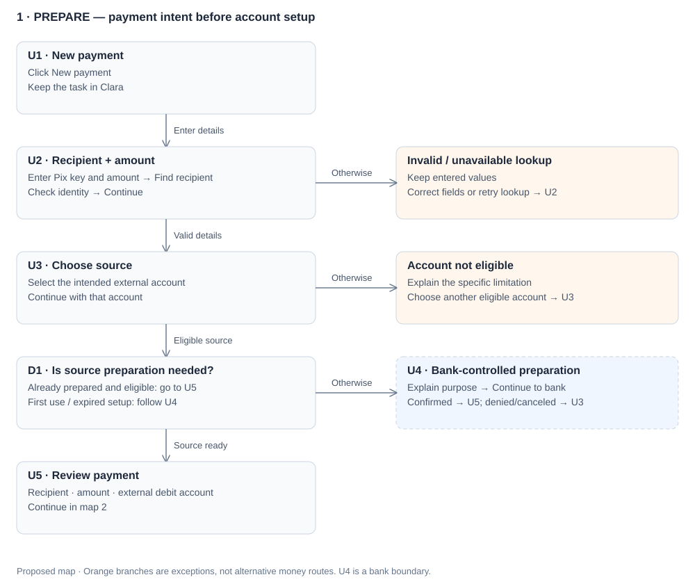

**Actions:** New payment → enter Pix key and amount → find recipient → choose an eligible account → prepare the account if needed → review. Invalid details stay editable; an unavailable account or canceled connection returns to source selection with the payment draft intact.

### 2 · Review and obtain the required decisions

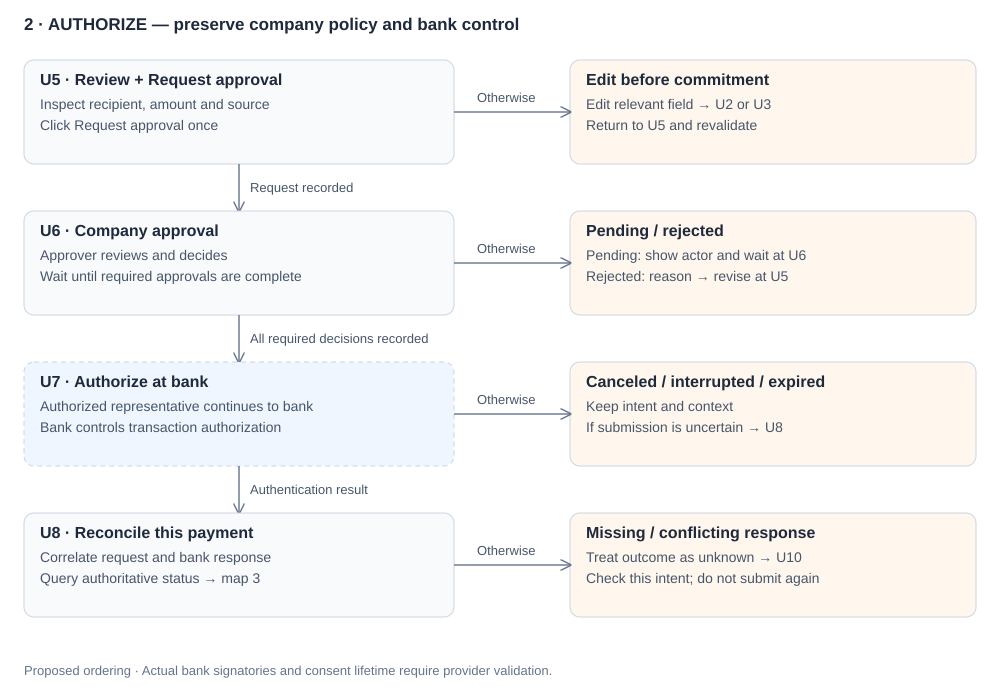

**Actions:** review and edit → save request → wait for the named company approver → authorization becomes available after approval → authorized representative confirms on the linked device → check payment status. Rejection returns a reason to the requester. Changed details require a fresh review and applicable approvals. An interrupted confirmation preserves the request; uncertain submission leads to a status check of the same payment.

### 3 · Confirm the outcome or recover

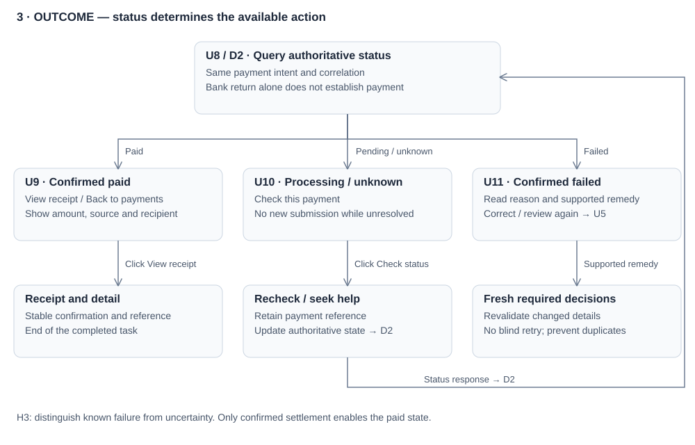

**Outcomes:** confirmed paid → receipt; processing or unknown → check the same payment; definitive failure → show the reason and a supported remedy. A corrected request returns to review with renewed approvals where required. An unresolved outcome keeps repeat submission unavailable.

> **Key decision:** retain the same payment identity through authorization and recovery. This is where continuity becomes both a usability and a duplicate-payment safeguard.

### Roles, approval policy and operational scale

The company context is approximately 200 collaborators. Even if all have platform access, payment permissions and approval responsibility depend on their assigned roles. The brief describes dozens of supplier payments per week; employee count alone cannot establish the number of approvers or concurrent payments.

Clara already supports rules by amount, payment method, requester role, location and group, with automatic approval/rejection and up to five review layers. I preserve that mechanism. The main test scenario uses a configured supplier-payment review assigned to Carlos; this is an illustrative policy, not a claim about the company’s actual configuration. All required company decisions must finish before payment-specific authorization. [Clara approval configuration](https://ajuda.clara.com/hc/pt-br/articles/41962086294291-Como-crio-um-fluxo-de-aprova%C3%A7%C3%A3o-de-pagamentos-na-Clara), [Clara user roles](https://ajuda.clara.com/hc/pt-br/articles/6210232061203-Quais-s%C3%A3o-os-n%C3%ADveis-de-usu%C3%A1rios).

For scale, I organize work as independent requests: queues by state, named responsible actors, searchable rows, transaction references and retained drafts. A queue banner explains the selected group rather than adding a banner for every request. New payment preserves existing work; a service response updates its own request. I would evaluate queue interpretation, recovery and effort across repeated payments. Rules with automatic or multiple reviews belong in validation variants; the case focuses on the same initiation service rather than building a new policy editor or batch processor.

## Hypotheses and validation

For this interview case, I use the following questions to inspect simulated scenarios with the same recipient, amount, debit account and approval policy. They define what the proposal should make understandable; they are not participant findings.

| Hypothesis / flow moment | Task to test it | Revise the design if… |
| --- | --- | --- |
| **H1 · Source choice:** keeping the named account in payment context improves source selection. | Ask for a payment from Bank A while Bank B is also available; ask which account will be debited. | The person chooses the wrong source, expects a Clara top-up or leaves the task to identify the account. |
| **H4 · Review:** grouping recipient, amount and source with adjacent editing helps catch mistakes. | Place one mismatch in the review; observe detection and correction. Reverse variant order where feasible. | They miss the mismatch, skip review or introduce another error while correcting it. |
| **H2 · Commitment:** explicit actions clarify company approval, bank authorization and payment completion. | At approval and device authorization, ask what the action permits and who acts next. | Connection is understood as blanket permission, or approval as payment already sent. |
| **H3 · Recovery:** retaining the request and state-valid actions supports safe resumption. | Interrupt authorization; separately show an unknown outcome. Observe the next action. | They lose context, re-enter valid data or attempt another payment while the outcome is unknown. |

### What determines the next iteration

**Experience measure:** active handling time for an equivalent, correctly completed task, with passive waiting recorded separately. Record errors, help and unnecessary navigation alongside completion; include failed and abandoned tasks in the findings.

**Critical issues:** wrong source, missed payment details, approval mistaken for settlement, an unsafe repeat submission or an inaccessible essential action require revision before consolidating the flow.

**Later business check:** in a pilot, track unique eligible payment intents reaching confirmed settlement divided by eligible intents started, within a defined window. Retries remain the same intent; segment first and repeat use. A baseline is needed before setting an uplift target.

The interactive prototype is the single implementation used for exploration and presentation. After source-route selection, it starts with payment details and uses the shared DS wizard. The scenario walkthrough exposes source comprehension, review and recovery for discussion. Provider eligibility and service requirements remain documented in Brief and scope; visual rules and accessibility checks are in the design system.

## Visual and interaction direction

| Design decision | Purpose |
| --- | --- |
| Nunito Sans; 20/28 page title, 16/24 section, 14/20 UI, 12/16 supporting text | A compact hierarchy for a working financial tool. |
| Spacing of 2, 4, 8, 16 and 24 px | Related content sits closer than separate decisions. Container gaps avoid accumulated margins. |
| 32 px default controls; 40 px large controls | Consistent alignment and predictable actions across forms and toolbars. |
| Neutral Slate surfaces; blue actions and selection | Keep attention on the task. Status also uses text and meaningful icons. |
| Restrained borders and elevation | Distinguish workspace, task and overlay without wrapping every item in a card. |
| Shared loading and restrained transitions | Explain state changes; respect reduced motion. Animation never determines payment success. |

Mercury informs grouped inputs and account identity; Nubank informs review and results; Apple Wallet informs setup sequencing. Detailed visual references remain in Desk research. These choices are local case decisions, not Clara's official DS or measured usability improvements.

### Why use the branded transition

I use a short branded transition to create a sense of care and confidence when the user enters a financial task. The pause signals a change in attention: the next step asks them to check recipient, amount and funding source. Translucency and light blur keep the workspace recognizable while bringing the payment into focus.

The familiar brand symbol and restrained motion make the passage feel less abrupt and monotonous. Repeating this feedback at meaningful moments gives the product a coherent character and can support perceived security and reassurance. This is an intentional emotional layer of the experience, alongside its functional clarity; reduced motion preserves the same orientation.

## A design system that AI can use

I created an executable design foundation so AI-assisted implementation can reuse decisions instead of inventing styles for every screen. Human-readable guidance explains intent; machine-readable tokens, component metadata and checks constrain implementation.

| Foundation | What it gives the implementation |
| --- | --- |
| Public API · `@/design-system` | One supported import path for components and patterns. |
| Registry · `src/design-system/registry.ts` | Tokens, component roles, variants and source locations in one maintained definition. |
| Generated CSS, JSON manifest and shadcn registry | The same foundation available to code and tooling, without independently maintained copies. |
| `DS_CONTRACT.md` | Rules for hierarchy, spacing, semantics, state feedback and composition. |
| Component documentation | Working previews, usage examples and source code for inspection before reuse. |
| `ds:check` and build | Detect stale generated artifacts and covered import/token violations. They do not judge the entire UX. |

**Working rule:** reuse an existing pattern; add a registered variant when needed; extend the component only when the requirement is reusable; generate and check; inspect the result. I retain responsibility for scope, hierarchy and behavior. AI use does not replace design review.

**Case contribution:** Wizard for guided tasks and progress; InputGroup for explicit field actions and mobile composition; ReviewSummary for recipient, amount and source; Brand loading and flow illustrations for state feedback. Compact upload and correction/history compositions support the same payment task. These are local case contributions, not changes to Clara's production library.

### How the foundation is shared

The hub, prototype, showcase and component catalog import the same local source through `@/design-system`. This is a shared code API, not a remotely hosted design-system service. The registry generates the artifacts used by tooling; the payment lifecycle remains domain code outside the visual components.

To inspect reuse, open the catalog's Button examples, compare its variants with the live showcase example, then inspect the code and contract. For behavior, explore the prototype scenarios. Automated checks cover specified rules and interactions; visual review still determines whether the composition communicates the right hierarchy.

### Contributing patterns across markets

This is a proposed contribution to a shared system, not a claim that Clara adopted the case library. I would bring Wizard, InputGroup and ReviewSummary to the DS team with the task, alternatives, reusable API, interaction states, keyboard behavior and mobile examples that motivated each pattern.

The shared layer should handle sequence, field-action composition and review hierarchy. Pix keys, CPF/CNPJ formatting, BRL amounts, local account eligibility and authorization policy belong in the Brazilian domain layer. Labels, values and formatted amounts should be supplied by the consumer instead of hardcoded into a supposedly global component.

Before adoption, I would compare the proposal with existing patterns in other markets, test longer translated labels and local formats, and agree on variants and ownership with the DS team. I would contribute documentation and regression checks alongside the component, then pilot it in a second flow before expanding its use. The current case demonstrates local reuse across three surfaces; cross-market validation remains next work.

## Brazil constraints and feasible scope

I am designing for Brazilian business accounts and Pix. Open Finance involves consent, authentication at the account-holding institution and confirmation of the operation. A connected account does not by itself authorize every future payment. I propose payment initiation without redirection after account and device linking. First use confirms the link at the bank; subsequent eligible payments are authorized in Clara with the device security mechanism. Company approval remains a separate decision. [Central Bank: Open Finance customer journey](https://bcb.gov.br/estabilidadefinanceira/cliente-open-finance?modalAberto=credito-personalizado), [Central Bank: payment initiation](https://www.bcb.gov.br/detalhenoticia/568/noticia).

Before a production implementation, the authorized initiator or partner, participating banks, PJ account eligibility, authorized representatives, bank approval layers, limits and current journey specifications would need confirmation. I document these as implementation dependencies. Bank selection should reflect verified eligibility, not imply that every bank or business account is supported. I have not established Clara's authorization or partner setup for this feature. The normative pages for Resolution 406 and Instruction 760 did not expose their full text in the research tool; their current applicability remains a verification task rather than a settled design claim.

For privacy, the LGPD's purpose, necessity, transparency and security principles inform minimizing data in the interface and prototype. Open Finance payment consent and the legal basis for other personal-data processing are separate considerations. Personal data can appear even in a business-account journey; a legal review must define lawful basis, retention, roles and notices before production. This case uses fictional data and stores no real credentials. [LGPD, especially Articles 6, 7 and 46](https://www.planalto.gov.br/ccivil_03/_ato2015-2018/2018/lei/l13709.htm).

For accessibility I will check keyboard access, visible focus, labels, textual errors and status messages. A 32 px visual control can remain compact while respecting applicable target-size and spacing requirements; dense icon actions need particular review. WCAG 2.2 guides these checks. [WCAG 2.2 quick reference](https://www.w3.org/WAI/WCAG22/quickref/).

**In scope:** one supplier, BRL, one Pix payment, two fictional source choices with one account connected in the task, first connection, payment-specific authorization, existing company approvals, result tracking and one main recovery scenario. Bank options use fictional data; production options require verified eligibility.

**Out of scope:** batch execution, recurring or automatic Pix, FX, a full bank-management module, real integrations and a complete compliance implementation. These can be discussed as dependencies or future opportunities.

### Account preparation and payment initiation

Open Finance has journeys with bank redirection and a separate framework for payment initiation without redirection. The latter separates account linking from transactions; the initial linking confirmation takes place at the account-holding institution. Relevant sources are [BCB Resolution 406](https://www.bcb.gov.br/estabilidadefinanceira/exibenormativo?numero=406&tipo=Resolu%C3%A7%C3%A3o+BCB) and [BCB Instruction 760](https://www.bcb.gov.br/estabilidadefinanceira/exibenormativo?numero=760&tipo=Instru%C3%A7%C3%A3o+Normativa+BCB). Their indexed summaries support this distinction; the full normative text, current applicability and PJ integration remain verification tasks.

I choose the no-redirection direction because the brief asks for continuity and the manager pays suppliers repeatedly. The prototype uses two shared wizards: prepare the account and device, then create and authorize the Pix. This is a conditional proposal: the public material I consulted includes restricted PF/mobile rollout, which does not establish availability for the PJ/desktop scenario. Verify the provider, supported accounts, signatories, device mechanism and current rollout before committing to implementation. [Open Finance Brasil: JSR pilot](https://openfinancebrasil.atlassian.net/wiki/spaces/OF/pages/1449754670).

## Two-day delivery plan

| Window | Work | Reviewable output |
| --- | --- | --- |
| Day 1 — frame and decide | Finish this bounded desk research; map experience hypotheses; identify PJ dependencies; compare interaction structures | Brief-defined opportunity, hypotheses, journey and state map |
| Day 1 — build | Reuse the DS for first connection, payment entry and review | A compact high-fidelity happy path |
| Day 2 — recovery and checks | Add authorization interruption, processing and unknown outcome; run available usability or heuristic checks | Clickable prototype, issues and explicit limitations |
| Day 2 — prepare the walkthrough | Refine hierarchy and copy; document alternatives, DS contribution and AI use; rehearse | A 30-minute walkthrough with 15 minutes for discussion |

Friday's presentation should make my judgment visible: what I observed, how I translated the brief into design decisions, how the flow protects approvals and authorization, what I learned from checks and what still depends on implementation validation. I will prioritize one coherent experience over an expanded feature set.

## Discovery: empathy map and user voice

I focus on the finance manager in the brief: a company with approximately 200 collaborators, two traditional banks and dozens of supplier payments each week. The employee count describes the organization; it does not establish 200 payment users. Requester, company approver and bank-authorized representative are responsibilities whose overlap remains unknown.

My working scenario is a supplier payment with funds at another bank. I add a company decision and an interrupted authorization as test conditions, rather than observed details of a particular customer's routine.

| Empathy lens | Established evidence | Working need and neutral discovery prompt | Decision it informs |
| --- | --- | --- | --- |
| Does | The brief describes opening the bank, funding Clara, returning and paying. | What information is repeated or kept elsewhere? “Walk me through the last payment like this.” | H1: preserve the source decision in the payment task. |
| Thinks | Payment details and company approval rules are documented. | Which details determine readiness? “What do you check before continuing, and why?” | H1/H4: source identity, recipient, amount and review hierarchy. |
| Feels | No emotional evidence has been collected. | An interruption may introduce uncertainty. “What information would you need to decide what to do next?” | H3: authoritative outcome and a valid recovery action. |
| Says | No interview quotes have been collected. | “What happened here?” “What would you tell the supplier?” | H2: distinguish a created request, authorization and settlement. |
| Pain | Separate funding is explicit; chasing approvers and repeated checking are unverified. | “Where do you spend time doing something, and where are you waiting?” | Identify where active effort and waiting occur within the payment task required by the brief. |
| Gain | The task requires paying the supplier with the necessary controls. | “What tells you this work is finished?” | Confirmed outcome and retrievable evidence; verify whether these resolve the user's task. |

I will refine this provisional map with observations from the finance manager: their role, task, words and the design decision each finding changes.

For Clara, the candidate value is easier completion of eligible supplier operations in Accounts Payable. The current evidence supports investigating effort reduction; adoption, repeat use and completion uplift require customer and production evidence. Safe authorization, correct source and no duplicate payment remain guardrails.

## Jobs to be done and decision traceability

**Primary job, inferred from the brief:** When I need to pay a supplier and the funds are at another bank, help me use the intended account within the payment task, so I can complete the work without organizing funding separately. Required company decisions, bank authorization and recovery constrain how I deliver this job.

**Business job:** Make eligible supplier operations easier to complete and track within Clara's Accounts Payable workflow. I would evaluate completion and repeat use in a pilot, against an established baseline.

The finance manager is the focal role. Internal and bank authorization responsibilities may be held by different people; I keep the handoff explicit and verify the actual role model before implementation.

## Design and engineering contributions

### My contribution: connecting intention to behavior

The central thread of this case is how I turned a financial task into design decisions that could be implemented and inspected. I worked across the operation, interaction, visual language and component architecture. AI assisted with exploration and code; I set the criteria and kept challenging the result until the composition and behavior reflected the intended experience.

Three moments make that connection visible. I moved source choice next to New payment because its placement should explain its purpose. I directed a short branded transition because entering financial details should feel considered and continuous. And I challenged the mobile table because rendering the same information was not enough if the person could not comfortably use it. Each decision required changes to both presentation and behavior.

### From the existing operation to the new source

I kept the opportunity defined by the brief: initiate a supplier Pix in Clara using funds at another bank. I reviewed the demo and references before changing the journey, then retained the existing Clara-balance route and company-control context. The external-bank proposal adds an option to that operation.

### Decisions that changed the interface

| Decision | Alternative considered | Why I changed it |
| --- | --- | --- |
| Source choice anchored to New payment | A separate choice modal | The popover keeps this short decision close to the action that started it. |
| One Pix field with explicit actions | Asking the person to classify each key | Recognize the input format, keep paste and simulated scan intentional, and show recipient details before review. |
| Readable payment rows on mobile | A compressed desktop table | Preserve filters and selection behavior while giving the information enough room. |
| Saved request with progress and history | Treating approval as completion | Show who acts next and distinguish company approval from payment authorization. |
| Correction preserves the request | Restarting the task | Keep valid details, expose the reason and obtain a fresh review after changes. |

### The design reasoning behind my interventions

My instructions covered more than visual polish. I directed how the interface should organize attention, reveal choices and communicate state. The principles below describe the reasoning behind concrete requests I made during iteration.

| What I directed | Design reasoning | What changed |
| --- | --- | --- |
| Keep only one sidebar group expanded; select the available destination on entry | Progressive disclosure and recognition reduce the need to search through unavailable routes | Navigation exposes the current group and takes the person to an implemented destination. |
| Preserve the existing navigation and Clara-balance option | Familiarity and consistency with the existing product | The proposal fits the current operation instead of presenting an isolated replacement. |
| Put source choices in a compact popover beside New payment | Proximity connects the choice to its trigger; restrained emphasis protects hierarchy | The separate modal and oversized choices were replaced with an anchored entry. |
| Recognize Pix formats, but keep paste and scan intentional | Recognition reduces classification work; explicit actions preserve user control | The unified field and simulated scanner share validation while keeping the initiating action clear. |
| Give recipient identity and amount the right space; remove redundant explanations | Visual hierarchy, grouping and minimalist presentation | Review information became more compact and relevant details received stronger emphasis. |
| Distinguish filter and approval icons, and make hover visible | Consistent meaning and visible interaction feedback | Icon choices and surface contrast were revised rather than relying on labels alone. |
| Use a short branded transition with the workspace still visible | Emotional design: perceived care, reassurance and continuity during a consequential task | I directed the full-screen composition, transparency, blur and shorter duration after repeated loading felt slow. |
| Introduce the feature in the sidebar without taking over the workspace | Contextual discovery and an invitation to try the new route | The banner moved into the sidebar; its copy, illustration and CTA were iterated for clarity and density. Adoption remains a hypothesis. |

The prototype brings these intentions together so the evaluator can inspect the composition, try the interactions and follow the reasoning behind them.

### From visual principles to technical constraints

I directed the library styling and composition as part of the solution: typography, spacing, semantic color, component states and icon meaning needed to work together. I requested the Phosphor migration, challenged inconsistent image captions and button treatment, and asked why a shared DS API was not producing more consistent code. Reuse was an implementation requirement, not just a catalog to display.

The component layer should preserve those decisions across the hub, prototype and showcase. The behavioral layer must also remain coherent: a mobile payment row can differ from a desktop table without changing selection rules; company approval cannot silently become payment authorization. I asked for automated coverage of those interactions alongside visual and heuristic review.

### Design decisions carried into code

I requested a shared DS API and clean English code so the implementation could express reusable decisions. Wizard, InputGroup and ReviewSummary organize the task; brand feedback, upload and state compositions support it. React and TypeScript implement simulated state transitions. Payment lifecycle rules and queue selectors are separate from the UI; desktop and mobile share selection behavior.

AI assisted with implementation and checks. My contribution includes framing, visual and interaction direction, reviewing the actual result, and deciding which corrections should become shared patterns. The work log below records specific interventions rather than attributing all generated code to manual implementation.

### How to inspect the implementation

I wanted the repository to expose the reasoning behind the interface. A reviewer can follow a visual decision into a shared component, then see how that component behaves in a payment task and how the behavior is checked.

[Explore the GitHub repository](https://github.com/nanag-carvalho/clara-product-finance-case). Start with the [application guide](https://github.com/nanag-carvalho/clara-product-finance-case/blob/main/central/README.md), then follow the boundary that interests you:

| Decision | Where it lives | Why I asked for this boundary |
| --- | --- | --- |
| Share design decisions across surfaces | [DS registry](https://github.com/nanag-carvalho/clara-product-finance-case/blob/main/central/src/design-system/registry.ts) and [public contract](https://github.com/nanag-carvalho/clara-product-finance-case/blob/main/central/DS_CONTRACT.md) | Tokens, variants and component APIs should carry the same hierarchy into the hub, prototype and showcase. |
| Compose patterns from smaller controls | [Shared components](https://github.com/nanag-carvalho/clara-product-finance-case/tree/main/central/src/components/shared) | Wizard, InputGroup and ReviewSummary express reusable interaction decisions instead of repeating screen-specific styling. |
| Keep financial rules outside presentation | [Payment domain](https://github.com/nanag-carvalho/clara-product-finance-case/tree/main/central/src/prototype) | Approval, authorization and uncertain outcomes need explicit transitions. Changing the mobile layout must not change these rules. |
| Make the story inspectable | [Showcase narrative](https://github.com/nanag-carvalho/clara-product-finance-case/blob/main/central/src/CaseStory.tsx) | The visual case links decisions to working artifacts; the hub keeps the detailed evidence and AI log. |
| Check behavior through the interface | [Browser tests](https://github.com/nanag-carvalho/clara-product-finance-case/tree/main/central/tests/e2e) and [CI](https://github.com/nanag-carvalho/clara-product-finance-case/blob/main/.github/workflows/build.yml) | Entry, approval, authorization, recovery and mobile controls need regression coverage alongside visual review. |

The DS is shared source within this repository, imported through its public TypeScript API. The generated manifest and registry expose its contract and installation metadata; they are not a remote banking service. [Architecture decisions](https://github.com/nanag-carvalho/clara-product-finance-case/blob/main/central/ARCHITECTURE_DECISIONS.md) explain the implementation tradeoffs. Local deployment copies, dependencies and QA captures stay outside Git; the repository keeps source, evidence and reproducible checks.

### What the checks establish

Type checks, registry checks and builds verify covered code and DS constraints. Browser tests exercise selected interactions; domain tests cover rules such as permissions and uncertain outcomes. These checks support regression detection. They do not prove usability, accessibility conformance or production readiness, and visual review found problems that passed the automated suite.

### Scenario coverage: what a reviewer can inspect

The prototype contains **12 named scenarios**, connected to **4 experience hypotheses**, across preparation, company decisions, authorization, outcomes and recovery. The case has four complementary surfaces: the visual showcase, detailed hub, interactive prototype and live DS catalog. They let a reviewer inspect the reasoning, behavior and implementation at different depths.

[Open the scenario explorer](/prototype.html?explore=scenarios). The floating **Scenarios** button in the prototype reopens it at any time. Each scenario loads a saved state and names the hypothesis and behavior to observe. Empty/populated workspace controls and the Pix Copia e Cola example support further exploration; they are not counted as additional financial scenarios.

| Situation | User job and risk | Behavior to inspect | Hypothesis / measure to observe |
| --- | --- | --- | --- |
| First connection | Prepare a source while keeping the supplier request | Choose an unconnected bank, confirm connection and return to review | H1 · source-choice accuracy; retained details |
| Connected account | Prepare a repeat supplier payment | Recognize the available source and review recipient/amount | H1/H4 · source and review accuracy |
| Company approval pending | Know who must make the company decision | Review the request without interpreting approval as money moved | H2 · correctly identify next actor and state |
| Approved, awaiting authorization | Release an approved payment | Complete payment-specific device confirmation | H2 · distinguish approval from authorization |
| Completed payment | Verify the supplier payment outcome | Find confirmation, details and history | H2 · outcome comprehension |
| Rejected request | Correct the issue without repeating preparation | Find the reason, edit saved details and request review again | H3/H4 · recovery completion and correction errors |
| Canceled device confirmation | Resume interrupted authorization | Keep the request and existing approval | H3 · recovery without duplicate requests |
| Expired connection | Restore the funding source | Reconnect without losing payment context | H1/H3 · retained details and successful resumption |
| Insufficient funds | Resolve a source-balance problem | Read the cause and review another source | H3 · correct recovery choice |
| Bank limit exceeded | Distinguish a limit from a balance problem | Recognize the specific cause before retrying | H3 · error comprehension |
| Confirmed service failure | Recover when no transfer completed | Use the explicit retry route | H3 · recovery completion without unnecessary recreation |
| Unknown payment result | Avoid paying twice while awaiting confirmation | Check the existing request before another attempt | H2/H3 · duplicate attempts and state comprehension |

Across tasks, I would measure **active handling time for a correctly completed task**, record passive waiting separately and note errors, unnecessary switching and lost context. The brief motivates reducing preparation effort; these scenarios make that hypothesis testable, but do not establish a measured reduction.

### Automated coverage and participant evaluation

There are **39 domain/registry tests** and **14 browser test cases**. The browser suite executes applicable cases on desktop and mobile, totaling **27 runs**, with one mobile-only case skipped on desktop. It covers payment entry through approval and authorization, individual/bulk decisions, correction, unknown-result recovery, mobile filters/selection, showcase navigation, live DS controls, image inspection, destination-tab reuse and first-connection/scenario links.

The 12 product scenarios are not 12 automated end-to-end tests: some are inspectable demo states, while the browser suite covers selected journeys and regressions. Automated checks verify expected transitions and interactions. Participant sessions would evaluate comprehension, effort and recovery in the finance user’s actual context. I would ask the finance manager to prepare and track a supplier payment, and the assigned approver to review the company decision, using the same tasks and success criteria across variants.

## Prototype implementation and comparison

### What the prototype demonstrates

The proposed Overview and Payments sit under Accounts payable. Connected banks sits under Digital account. Existing Inbox and unrelated modules remain visible as context. Approval review is reached from payment queues; individual requests carry their progress and history.

| Brief requirement | Demonstration | Boundary |
| --- | --- | --- |
| First connection and consent | Account selection, permission explanation, bank confirmation boundary and device setup | Bank/provider and PJ eligibility are dependencies |
| Supplier payment | Recipient fixture, amount, source, review, company decision and device confirmation | No real Pix execution; dynamic charge resolution remains |
| Failure and recovery | Rejection/correction, canceled confirmation, expired link, balance/limit/service failure and unknown result | Responses are simulated |
| Reused components and DS contribution | Shared UI API, Wizard, flow states, Brand loading and compact upload | Accessibility conformance is not established |
| AI use | Tools, instructions, corrections and retrospective phase windows are recorded | Active effort and AI time savings were not measured |

### How to explore

Open **Scenarios** in the prototype. Each example opens the relevant request and labels its category and hypothesis. Filters and selection operate on fictional records; batch approval records decisions without authorizing a batch payment. Unknown results keep the same intent available for status checking.

### What remains a hypothesis

H1 concerns choosing the funding source in context; active handling time is the primary experience measure across the task. H2 concerns understanding responsibility and the next decision; H3 concerns recovery; H4 concerns review clarity. No user outcomes are measured. Automatic approval and multiple approval layers are recognized policy cases but are not simulated in the current prototype. New payment preserves the existing Clara-balance route alongside the proposed external-bank source. A unified Pix field recognizes keys and static Copia e Cola; QR scanning is a labeled camera simulation with the same decoded-code validation path. Recipient resolution remains fictional. Alternatives and unmeasured effort should be explained candidly in the walkthrough.
