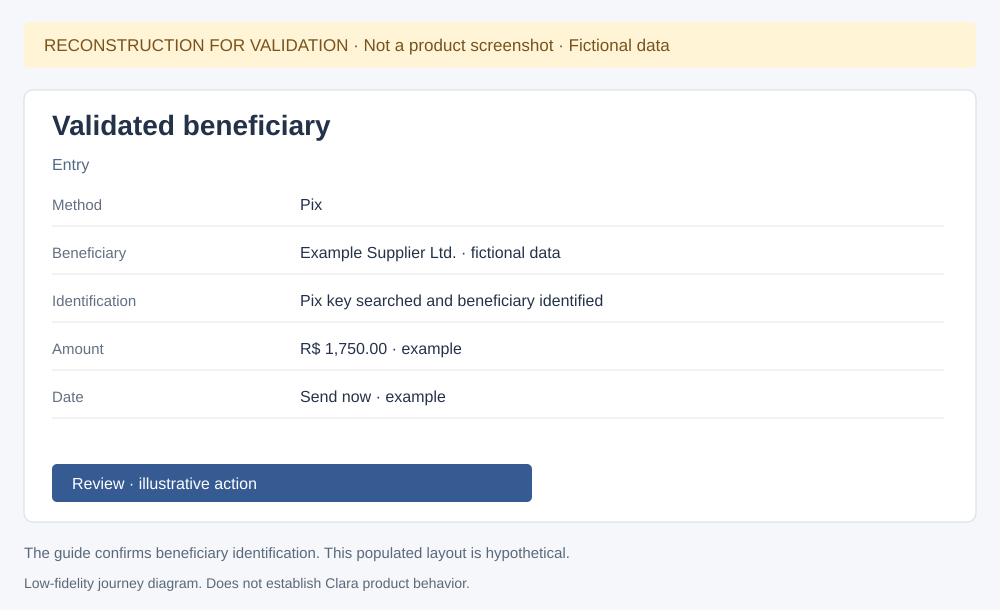
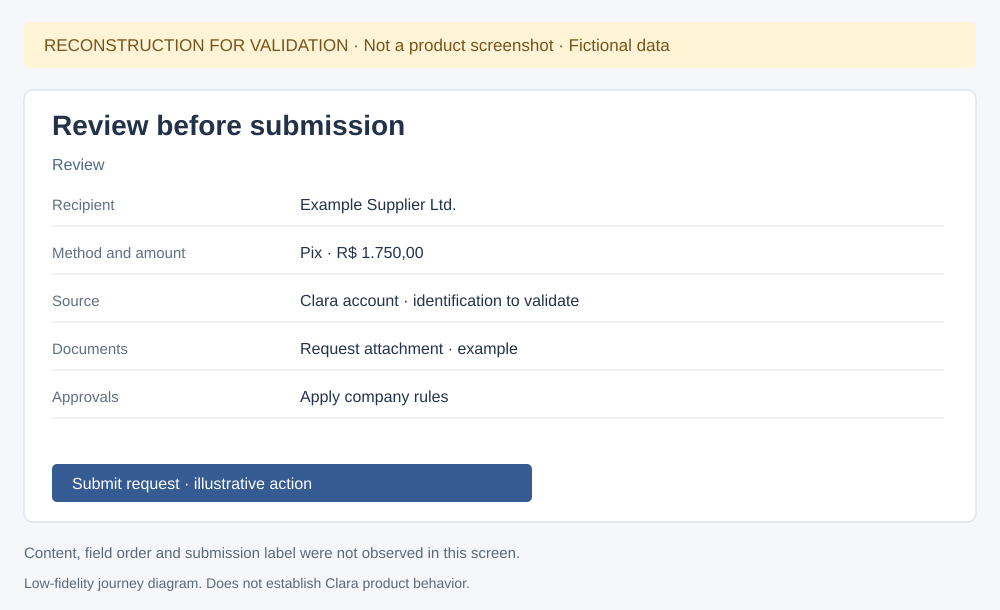
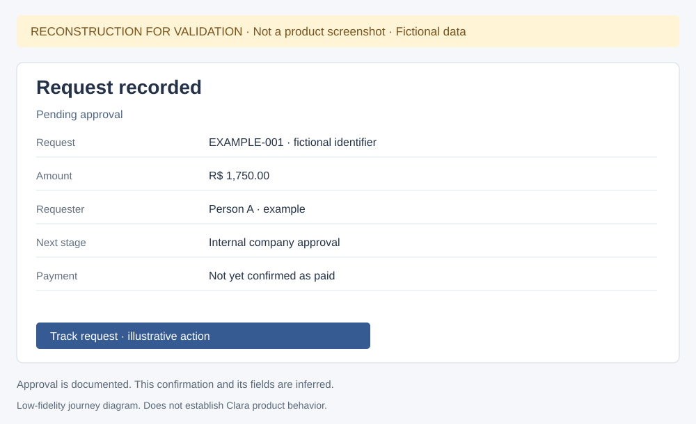
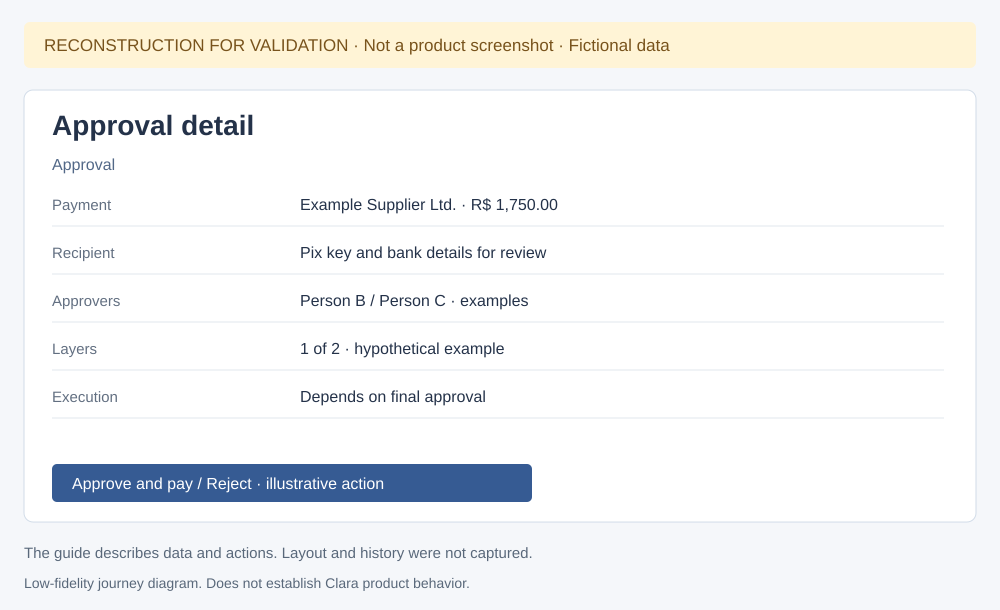
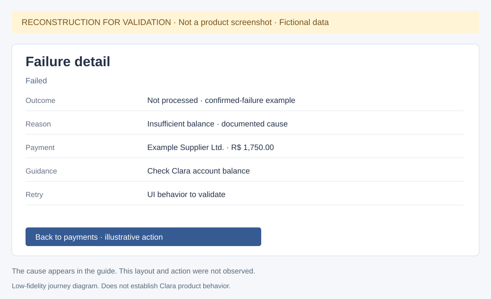
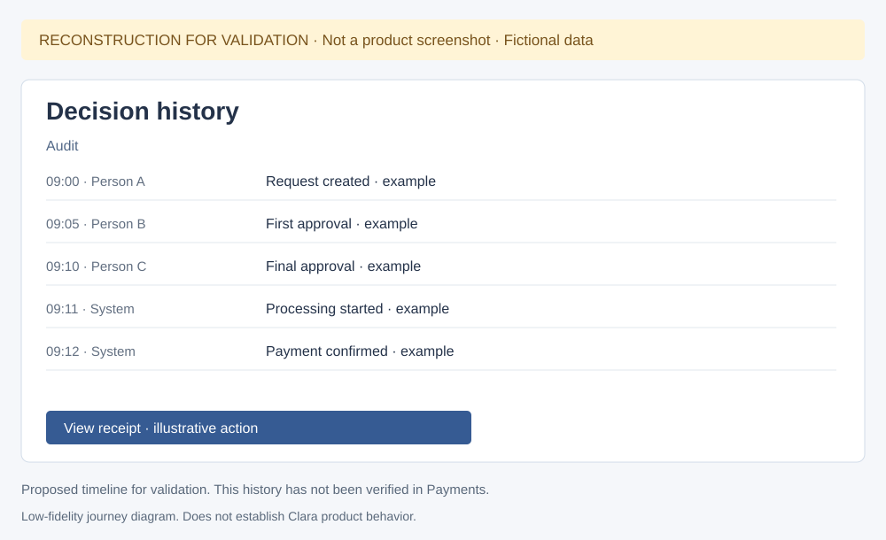

# Clara — reconstructed states for validation

I collected these low-fidelity diagrams to investigate states I have not captured yet. Every image is labeled as a reconstruction and uses fictional data. Each structure is hypothetical: it does not reproduce a confirmed interface and does not represent the Open Finance proposal.

[Back to documentation and real evidence](index.html#state-coverage-and-reconstructions-for-validation)

## Validated beneficiary

Beneficiary identification is documented. The populated layout and example data are inferred.

## Review before submission

The real form offers Review. I have not observed the complete summary or funding-source selection.

## Request recorded

This confirmation is hypothetical. The real email-code screen does not establish request registration.

## Approval detail

The guide describes details, approvers and actions. Layer count, people and layout are examples.

## Processing payment

The list and badge are real. The detail, actions and receipt availability are hypotheses.

## Failure detail

Insufficient balance is a documented cause. This confirmed-failure example differs from an unknown outcome.

## Decision history

The sequence and timestamps are examples. A decision timeline within Payments detail remains unverified.

